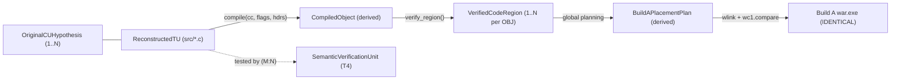

# RFC: Архитектура Build & Codegen Infrastructure и поэтапное восстановление оригинальных единиц компиляции Warcraft I

- **Статус:** Согласованный архитектурный консенсус (ожидает экспериментальной валидации `E0–E8` перед допуском новых механизмов в production)
- **Базовая точка (baseline):** `e14d5c0` / `d46f891` (`1010` функций в scope: `899` DONE, `914` семантически именованы, `519` buildable T3 [`518` Watcom 10.0a, `1` Open Watcom 2], `385` T4, `6` unchecked `ref`, `100` без C, `111` незавершённых)
- **Целевой артефакт:** `original/install/war.exe` (Warcraft: Orcs & Humans, DOS CD v1.22h, LE executable, DOS/4GW, Watcom C/C++ 10.0a, формат объектов OMF32)
- **Область действия:** архитектура верификации машинного совпадения (`wc1.match`), гибридной сборки Build A (`wc1.build`, `wc1.emit`, `wc1.omfpatch`), дифференциального тестирования (`wc1.cemu`, `wc1.emu`, `wc1.t4spec`), восстановления compilation units (`CU`), владения данными и детерминированного compiler-guided поиска (`wc1.permuter`, `wc1.t3_audit`, `wc1.wave4*`).
- **Вне области действия:** выбор моделей, агентных harnesses, распределение ролей, организация implementation campaigns, изменение scope проекта и изменение пользовательских verification gates (`docs/GOAL.md`, `wc1.progress`).

### Эпистемические обозначения документа

Чтобы исключить смешение доказанных фактов с проектными решениями и непроверенными предположениями, существенные утверждения маркируются явно:

- **`[VERIFIED]`** — подтверждено кодом репозитория, бинарным образом `war.exe` или воспроизводимым экспериментом.
- **`[DERIVED]`** — логически выведено из подтверждённых фактов при явно указанных предпосылках.
- **`[DECISION]`** — принятое архитектурное решение, обязательное для дальнейшего проектирования и не пересматриваемое без новых технических доказательств.
- **`[HYPOTHESIS]`** — техническое предположение, требующее экспериментальной проверки до допуска в production.
- **`[OPEN]`** — вопрос, принципиально неразрешимый умозрительно до завершения соответствующих экспериментов `E0–E8`.

---

## 1. Executive summary

Проект преследует две взаимосвязанные цели: достоверно восстановить исходный код *Warcraft: Orcs & Humans* (v1.22h) и выработать переносимые архитектурные принципы экономичной реконструкции существенно более крупных программ. Текущая инфраструктура успешно довела проект до `89.0%` DONE (`899 / 1010`) при побайтово идентичном Build A (`519` функций из C), но достигла структурного предела: стратегия `one function per file`, изначально выбранная как удобный технический инструмент гибридной сборки, вступает в противоречие с задачей восстановления оригинального compilation context, сама порождает неустранимые в standalone-режиме T3-расхождения и не масштабируется на проекты с десятками тысяч функций.

Центральный архитектурный вопрос RFC:

> **Как построить инфраструктуру, позволяющую постепенно восстанавливать исходный код в его естественном compilation context, сохраняя независимое доказательство машинного совпадения и побайтово идентичную гибридную сборку Build A на каждом промежуточном этапе?**

Настоящий RFC фиксирует согласованную архитектурную позицию:

1. **Развязывание гранулярностей (`[DECISION]`):** физическая организация канонического C-кода (`ReconstructedTU`), исторические гипотезы об оригинальных файлах (`OriginalCUHypothesis`), проверяемые машинные диапазоны (`VerifiedCodeRegion`), единицы поведенческой проверки (`SemanticVerificationUnit`) и глобальный план гибридной сборки (`BuildAPlacementPlan`) разделяются как независимые абстракции.
2. **Первоочередное устранение пробелов soundness в `wc1.match` (`[DECISION]`):** до принятия решений по новым механизмам закрываются три подтверждённых дефекта верификации (ведущие байты `_TEXT`, обратная проверка оригинальных LE-фиксапов, проверка указательных полей в локальных сегментах данных) и проводится обязательный повторный аудит всех `519` существующих T3.
3. **Контракт `CandidateRegion → VerifiedRegion → PlacementPlan` (`[DECISION]`):** поддержка pre-function jump tables (`Fix B1`) и верифицированных cut-boundary переходов в Build A (`Fix B2`) строится не как набор адресных исключений, а внутри единого минимального контракта верифицированных регионов кода.
4. **Строгие границы допустимых OMF-преобразований (`[DECISION]`):** вводится инвариант *Post-Codegen Symbolic Relocation Equivalence*, исключающий любые пост-компиляционные правки машинных операций и разрешающий только доказанные преобразования релокаций и границ секций с полной фиксацией в provenance.
5. **Эволюция через эксперименты (`[DECISION]`):** перспективные механизмы — data-anchor decoupling (`Fix B3`), выборочная OMF-экстракция (`selective OMF extraction`) и многофункциональный T4 (`Isolated` / `Group` / `Integrated` с явными verification boundaries) — **не объявляются готовыми к production заранее**; сроки и форма их внедрения относительно завершения M2 определяются результатами ограниченной экспериментальной программы `E0–E8`.

---

## 2. Контекст и недостатки текущей архитектуры

### 2.1. Подтверждённые сильные стороны текущей инфраструктуры (`[VERIFIED]`)

- **Побайтовая идентичность Build A:** конвейер `wc1.emit → nasm -O0 → wc1.omfpatch → wlink → wc1.compare` проверяет не только загружаемый образ, точку входа и стек, но и все `8770` LE-фиксапов (`docs/subsystems/build.md`).
- **Оригинальный компилятор в контуре:** Watcom C/C++ 10.0a установлен с проверкой SHA-256 и smoke-тестом compare promotion (`tools/wc1/oldcc.py`); параллельная проверка компиляции под Open Watcom 2 сохраняет сборку открытым компилятором (`make compile-check`).
- **Защищённый T4-контур и dependency-scoped кэширование:** статический AST-фильтр в `wc1.symbols`, runtime-аудит `WC1_T4_AUDIT_LOG` в `wc1.cemu`/`wc1.t4spec` и schema-v2 dependency-scoped отпечатки в `wc1.wave4_fp` (с fail-open поведением при неполных метаданных).

### 2.2. Подтверждённые системные ограничения (`[VERIFIED]`)

1. **Три пробела soundness в `wc1.match` (`tools/wc1/match.py`):**
   - *Ведущие байты `_TEXT`:* `match_module()` начинает сравнение со смещения первого публичного/статического символа `starts[0][0]` (`tools/wc1/match.py:246`) и пропускает `_TEXT` в проверке сегментных данных (`tools/wc1/match.py:272`). Байты `[0, starts[0][0])` (в частности, таблицы переходов `switch` перед функцией, как `0x157d8..0x157e8` перед `ChooseCampaignDialog`) и их релокации вообще не проверяются в `wc1.match`.
   - *Односторонняя проверка релокаций кода:* цикл по релокациям (`tools/wc1/match.py:216-244`) обходит только `text.fixups` скомпилированного объекта, но не проверяет, что каждый оригинальный LE-фиксап из `p.fix_at` в проверяемом диапазоне воспроизведён релокацией в объекте. Численно совпадающий захардкоженный адрес без OMF `FIXUPP` проходит `wc1.match` (и отлавливается лишь позже в `wc1.compare` при сборке).
   - *Непроверенные указатели в локальных данных:* `build.py:101` маскирует `seg.fixups` с комментарием `# pointer fields: compared by wc1.match`, однако `match.py:280-286` **также только маскирует** `s.fixups` при побайтовом сравнении и никогда не проверяет целевые адреса этих указателей. В отличие от первых двух пробелов, эту ошибку **не гарантирует поймать даже Build A `IDENTICAL`**, поскольку физическим провайдером данных остаётся оригинальный ASM.
2. **Жёсткая связка кода и данных в `wc1.build` (`tools/wc1/build.py`, `asm/wc1.inc`):**
   - `build.py:108-109` запрещает одному C-объекту иметь data-сегменты по нескольким разным адресам (`len({a for a, _ in anchors}) > 1`), что **структурно делает невозможным размещение целого многосегментного CU** (например, содержащего одновременно `_DATA` и `CONST` или `_DATA` и `_BSS`).
   - `build.py:129-131` требует монотонного порядка всех data anchors в кодовом порядке (`dseq == sorted(dseq)`), при этом `asm/wc1.inc` схлопывает оригинальные `_DATA` (`0x50000..0x569d0`) и `CONST` (`0x569d0..0x5853c`) в один сегмент `_DATA`. Как следствие, `SaveErrorDialog` (`0x1aca8`, якорь в `_DATA` `0x51ea6`) конфликтует с более ранним `DefeatDialog` (`0x1ab28`, якорь в `CONST` `0x56c0c`), а разделяемые строковые литералы (`0x56bf8` `"Error saving game!"`, `0x52538` `"path.war"`) вынудили ввести искусственные `extern`-символы данных в канонические C-файлы.
3. **Допущение нулевого смещения первой функции (`tools/wc1/build.py:64-70`):** `place()` вычисляет `base = min(e["addr"] for e in funcs)` и требует `pub[1] == e["addr"] - base`, отвергая все объекты с pre-function jump tables (`13` функций в scope, включая `ChooseCampaignDialog` `0x157e8`, `MainMenu` `0x15588` и `0x19c14`).
4. **Запрет внутренних ссылок при shared epilogues (`tools/wc1/emit.py:45-84`):** `replaced_interior_refs()` отвергает интеграцию побайтово-идентичных T3-функций (`ApplyScenarioTerrainKindRects`, `IntroOpPlaySound`, `UnitFinalizeGone`, `SelectionClickUnit`, `MissionDefeat` и ещё `6` T4-функций), в чей эпилог переходят соседние ASM-функции. Формат OMF не поддерживает внешние 8-битные релокации для `rel8`-переходов.
5. **Искусственные T3-расхождения из-за `one function per file`:**
   - В `build/t3_audit/report.md:36` зафиксировано, что при совместной компиляции `DialogItemHitTest` (`0x16cc8`) и `DialogHighlightOn` (`0x16d34`) в `src/mod_16390/dialog_hit_test_reference.c` Watcom 10.0a автоматически генерирует кросс-функциональный `je short` в эпилог предыдущей функции (`74 f5` против оригинального `74 f3`, разница 2 байта из-за длины тела `DialogItemHitTest`). В standalone-файле такой переход принципиально невозможен.
   - Аналогичные зависимости от TU зафиксированы в `PLAYFLIC.C` (`IntroOpWaitSound` `0x231cc → 0x2316c`, `IntroOpWaitAnim` `0x232ec → 0x230de`) и в `GAMEDLG.C` (`SaveErrorDialog`: standalone-компиляция под `-ot` даёт шаг строк `0x24` вместо оригинального `0x22` в `_DATA`, а случайное совпадение под `-os` в `report.md:35` маскирует расхождение data layout неверным флагом оптимизации).
6. **Ограничения `wc1.cemu` на многофункциональных файлах (`tools/wc1/cemu.py:146-161, 378-379`):**
   - `CModule` разрешает `local_names` (публичные и статические символы своего `.obj`) раньше глобальной БД символов. В результате intra-TU вызовы обходят `emu.stubs[orig_addr]`, а взятие адреса соседней функции (`&Sibling`) даёт адрес в heap эмулятора (`0x80xxxx`) вместо адреса в `war.exe`, вызывая ложные расхождения `watch` в `run_pair()`.
   - `cemu.py:379` трактует наличие любого stub внутри всего `cmod._c_ranges` как нарушение контракта (`c_stubbed`), не различая тестируемую функцию и её внешние зависимости в том же объекте.
7. **Устаревшие пресеты и беспамятный цикл ремонта:**
   - `tools/wc1/permuter.py:30-40` содержит лишь `8` пресетов Watcom 10.0a, унаследованных от исследования OW2 (отсутствуют `-5r`, `-3r`, `-zp1`, `-or`, `-oi` и ряд комбинаций с `-d1+`). Добавление `-5r` без единого вызова внешней эвристики уже подтвердило `14` новых совпадений и `76` улучшений mismatch score (`docs/research/m2-completion/blocker-analysis.md`).
   - `tools/wc1/wave4.py:662-680` при ухудшении результата откатывает текст без передачи истории неудачной попытки в следующий шаг, а при `COMPILE_ERROR` немедленно завершает попытку со статусом `FAILED`.
8. **Перегрузка понятия `module` в `analysis/modules.toml`:** один файл одновременно кодирует границы `zero16`, классификацию scope (`wc1.progress`, часть фиксированной линии финиша), гипотезы имён оригинальных `.C`-файлов и единицы разбиения работы, при этом часть диапазонов (`mod_13f60`, `mod_16390`, `mod_269f0`, `mod_31940`, `mod_3df40`) заведомо смешивает несколько оригинальных объектных файлов.
9. **Немасштабируемость `one function per file` (`[DERIVED]`):** на проектах класса 30 000+ функций (включая C++ с классами, инлайнингом, шаблонами, vtable и RTTI) стратегия «одна функция — один файл» неприменима ни по накладным расходам сборки, ни семантически.

---

## 3. Все 17 согласованных архитектурных решений (`[DECISION]`)

Перечисленные ниже решения составляют согласованный архитектурный базис и не пересматриваются без новых экспериментальных или формальных технических доказательств:

1. **`One function per file` не является конечной архитектурой проекта.** Это допустимая промежуточная единица реконструкции, но не доказанная оригинальная организация исходного кода.
2. **Канонический исходный код должен постепенно приближаться к обоснованным оригинальным compilation units.** Массовая миграция уже существующих исходников на текущем этапе не производится.
3. **Compilation context является частью доказательства машинного совпадения.** Существующие standalone T3 при этом остаются полноценными T3 при прохождении усиленного verification contract.
4. **Историческая достоверность CU и машинное совпадение — независимые измерения прогресса.** Новая сложная пользовательская шкала tiers (`T3a`, `T3b` и т. п.) не вводится.
5. **Matcher должен различать `FunctionMatch` и `RegionMatch`.** Все три подтверждённых пробела `wc1.match` закрываются обязательно и независимо от выбора дальнейшей архитектуры, с последующим повторным аудитом существующих `519` T3.
6. **Build Infrastructure развивается вокруг минимального контракта `Verified Code Regions`.** Состояния `CandidateRegion`, `VerifiedRegion` и `PlacementPlan` должны быть логически и программно разделены.
7. **`Fix B1` (pre-function jump tables) и `Fix B2` (cut-boundary interior branches в Build A) реализуются как части этого общего контракта**, а не как набор специальных исключений для отдельных адресов.
8. **OMF rewriting ограничивается доказанными преобразованиями класса `Post-Codegen Symbolic Relocation Equivalence`.** Запрещены любые исправления машинных операций ради достижения matching.
9. **Data-anchor decoupling (`Fix B3`) — стратегически необходимое направление развития Build Infrastructure.** Конкретная реализация и сроки его внедрения зависят от экспериментального подтверждения (`E5`).
10. **`Semantic owner` и `physical provider` данных разделяются.** Адаптеры Build A не должны искажать каноническую организацию C-кода и не могут появляться в канонических исходниках.
11. **Selective OMF extraction — предпочтительное направление исследования для инкрементального продвижения многофункциональных TU**, но не утверждённый production-механизм до успешного завершения `E4`.
12. **T4 verification развивается в сторону режимов `Isolated` / `Group` / `Integrated` с явными verification boundaries и dependency substitution policies.** Существующие anti-cheat гарантии не ослабляются.
13. **Compiler-guided search развивается на основе эмпирической калибровки оригинального Watcom 10.0a.** Исследовательская база возможностей компилятора, гипотезы об оригинальных флагах CU и production presets поиска строго разделяются.
14. **Compiler idioms вводятся постепенно:** сначала воспроизводимые наблюдения, регрессионные тесты и узкий набор строго ограниченных безопасных трансформаций; полноценный C-superoptimizer исключён из текущего scope.
15. **`Original CU recovery` ведётся отдельно от существующего scope (`analysis/modules.toml`).** Используются проверяемые ограничения, объяснимые эвристики и явная эпистемическая классификация доказательств.
16. **Все доказательства зависят от фактического compilation context и версии verification contract.** Кэширование и инвалидация обязаны учитывать эти зависимости.
17. **Последовательность архитектурной эволюции определяется результатами ограниченных экспериментов (`E0–E8`).** Известные дефекты soundness устраняются без задержек, но масштабная перестройка инфраструктуры не начинается без экспериментального подтверждения необходимости и осуществимости.

---

## 4. Концептуальная модель сущностей и отношений

### 4.1. Принцип хранения (`[DECISION]`)

> **Хранить исходные факты, гипотезы и необходимый provenance; производные доказательства вычислять воспроизводимо и кэшировать.**

Запрещено создавать вторую параллельную базу метаданных, которую пришлось бы вручную синхронизировать с `src/` и `analysis/symbols/*.toml`.

### 4.2. Четыре основные логические сущности и два производных артефакта (`[DECISION]`)

| Категория | Сущность | Назначение и жизненный цикл | Хранение |
|---|---|---|---|
| Основная | **`OriginalCUHypothesis`** | Историческая гипотеза об оригинальном `.obj`/`.C`-файле: границы, функции, предполагаемые диапазоны данных, гипотеза флагов, свидетельства и эпистемические статусы. | `analysis/compilation_units.toml` (отдельно от `analysis/modules.toml`) |
| Основная | **`ReconstructedTU`** | Фактический канонический C-файл, передаваемый компилятору (`src/.../*.c`), вместе с его рекурсивными заголовками. Не обязан немедленно совпадать по составу с `OriginalCUHypothesis`. | Git (`src/`) |
| Основная | **`VerifiedCodeRegion`** | Доказательно верифицированный машинный диапазон (функции, ведущие/хвостовые байты, обязательства релокаций и данных) в конкретном compilation context. | Вычисляемое доказательство; provenance кэшируется/фиксируется в `build/` |
| Основная | **`SemanticVerificationUnit`** | Функция или группа функций с явно заданной границей верификации и политикой подмены зависимостей для T4 differential tests. | Тесты (`tests/`) + ссылки `ref_verified_by` в `analysis/symbols/` |
| Производный | **`CompiledObject`** | Детерминированный результат компиляции `(ReconstructedTU, compiler, effective_flags, headers)` с его OMF-сегментами, символами и релокациями. | Эфемерный/кэшируемый артефакт в `build/` |
| Производный | **`BuildAPlacementPlan`** | Глобальный для всего образа план интеграции множества `VerifiedCodeRegion` и оставшихся ASM-кусков с выбором физических провайдеров данных и проверкой глобальных инвариантов. | Вычисляется в `wc1.build` на каждой сборке |

### 4.3. Отношения между сущностями

- Один `OriginalCUHypothesis` может временно покрываться несколькими `ReconstructedTU` (M:1), либо один `ReconstructedTU` может консолидировать часть или весь `OriginalCUHypothesis`.
- Один `CompiledObject` может порождать ноль, один или несколько непересекающихся `VerifiedCodeRegion`.
- `SemanticVerificationUnit` независим от физической нарезки `ReconstructedTU`: один дифтест может проверять отдельную функцию (`Isolated`), связную группу (`Group`) или подсистему (`Integrated`).

---

## 5. Контракт `FunctionMatch` и `RegionMatch`

### 5.1. Разделение уровней вердикта (`[DECISION]`)

Внутри `wc1.match` и зависимых инструментов (`wc1.t3_audit`, `wc1.build`, `wc1.wave4*`) вводятся два чётко различаемых уровня машинного соответствия (без изменения пользовательского статуса T3):

- **`FunctionMatch`** — доказательство совпадения машинного кода конкретной функции `f` в зафиксированном compilation context (`CompiledObject`): байты тела функции и её нормализованные адресные обязательства соответствуют оригиналу. `FunctionMatch` сам по себе **не гарантирует** интегрируемости объекта в Build A (например, из-за несовпадающих соседей в том же объекте, не проверенных ведущих таблиц или неразрешимых исходящих `rel8`).
- **`RegionMatch`** — доказательство совпадения **полного замкнутого интегрируемого региона** `[orig_start, orig_end)` внутри `CompiledObject`, включая ведущие байты (`[0, first_pub_off)`), все точки входа, все локальные данные-в-коде, допустимый хвостовой filler, все нормализованные релокационные обязательства и верификацию связанных данных (включая их указательные поля). Только `RegionMatch` допускает создание `VerifiedRegion` и передачу в `BuildAPlacementPlan`.

### 5.2. Семантическая двусторонняя проверка нормализованных адресных обязательств (`[DECISION]`)

Поскольку OMF `FIXUPP` (этап компиляции) и LE fixups (этап загрузки исполняемого файла) относятся к разным стадиям сборки, проверка полноты релокаций строится **не** как буквальное 1:1 сравнение таблиц OMF и LE, а через **нормализованные адресные обязательства (Normalized Addressing Obligations)**.

Каждое адресное поле (в коде или в данных) описывается нормализованной записью:

- `kind`: абсолютная ссылка в коде (`abs_code`), абсолютная ссылка в данных (`abs_data`), самоотносительная ссылка в коде (`rel32_code` / `rel8_code`);
- `src_offset`: смещение поля относительно начала региона (или сегмента данных);
- `field_size`: размер поля (`4` байта для 32-битных обязательств, `1` байт для `rel8`);
- `target`: целевой логический символ / адрес;
- `addend`: явное или инлайновое смещение относительно цели;
- `evaluation_rule`: правило вычисления машинного значения (`target + addend` либо `target + addend - (src_addr + field_size)`);
- `requires_static_resolution`: требуется ли разрешение на этапе линковки (например, внешний `call rel32` в `_TEXT`);
- `requires_le_fixup`: требуется ли сохранение runtime loader relocation в LE (истинно для абсолютных адресов объектов `CODE_OBJ`/`DATA_OBJ`, ложно для внутриобъектных `rel32` и аппаратных констант вроде VGA-буфера `0xa0000`).

Контракт полноты проверяется **в обоих направлениях**:

1. **Прямое направление (compiled → original):** каждая релокация в `CompiledObject` внутри региона (в коде и в используемых сегментах данных), а также каждый декодированный внутрисегментный `call`/`jmp rel32`, должен соответствовать валидному оригинальному адресному обязательству с совпадающими `kind`, `target`, `addend` и правилом вычисления.
2. **Обратное направление (original → compiled):** каждое оригинальное адресное обязательство региона — каждый LE-фиксап из `p.fix_at` в `[orig_start, orig_end)` (включая ведущие jump tables!), каждый LE-фиксап из `p.fix_at` в верифицируемых диапазонах `DATA`/`CONST`, и каждый оригинальный межфункциональный `call`/`jmp rel32` — обязано быть воспроизведено скомпилированным объектом.
   - *Аппаратные константы (`0xa0000`, `0x400` и т. п.):* в `war.exe` не несут LE-фиксапа и в C не несут OMF-фиксапа — проходят обычное побайтовое сравнение без ложного срабатывания.
   - *Ошибочно захардкоженный адрес `CODE_OBJ`/`DATA_OBJ`:* имеет `p.fix_at` в `war.exe`, но не имеет OMF `FIXUPP` в объекте — **отклоняется fail-closed**.

### 5.3. Требования к ведущим/хвостовым байтам и `extent retry` (`[DECISION]`)

- **Ведущие байты `[obj_lo, first_pub_off)`** (например, pre-function switch tables) обязаны проверяться полностью — и по байтам, и по всем адресным обязательствам.
- **Проверка `extent retry`:** допускается отсечение только чистого хвостового выравнивающего filler (`nop`, `mov r,r`, `lea r,[r+0]`, `0x00`), не содержащего ни одного `FIXUPP` и не скрывающего ни одного байта реального кода/данных до `orig_end`.

---

## 6. `Post-Codegen Symbolic Relocation Equivalence`

### 6.1. Формальный инвариант (`[DECISION]`)

Любое пост-компиляционное преобразование объектного файла OMF (включая `Fix B3` и потенциальный `selective OMF extraction`) обязано удовлетворять инварианту **Post-Codegen Symbolic Relocation Equivalence**:

> Преобразование объектного файла может изменять **только** представление секций, символов и адресных полей уже сгенерированных машинных инструкций и данных. Оно обязано сохранять исходную машинную семантику, доказанную идентичность объектов и отношений между ними.
>
> Каждое преобразуемое адресное поле обязано иметь независимо установленный источник, целевой объект, тип адресации и `addend`. Оригинальный бинарник используется для **проверки правильности** отображения, но **не может быть единственным источником** определения того, на что фактически ссылается скомпилированный код.

**Безусловные запреты:**

- Изменять opcode, длину инструкции или регистровые операнды.
- Изменять неадресные immediate values.
- Преобразовывать `short` branch (`rel8`) в `near` branch (`rel32`) или заменять одну машинную операцию другой.
- Подставлять оригинальные инструкции или существенные байты, отсутствующие в результате компиляции.
- Добавлять оригинальные alignment bytes, если они являются существенной частью проверяемого региона и компилятор их не воспроизвёл.
- Угадывать неизвестную цель исключительно по адресу из `war.exe` без независимого подтверждения символьной идентичности.
- Оставлять преобразование незафиксированным в provenance или обходить проверки `RegionMatch` и Build A `IDENTICAL`.

### 6.2. Политика по 8 конкретным случаям ссылок (`[DECISION]`)

| # | Случай ссылки в скомпилированном объекте | Статус (v1) | Условия допустимости / причина отказа |
|---|---|---|---|
| 1 | Intra-TU `call rel32` на известный символ вне извлекаемого региона | **Допустимо** | Целевой символ имеет независимую запись в БД, имя соответствует C-вызову, и оригинал по этому смещению вызывает `orig_addr(target)`. Преобразуется в `EXTDEF + FIXUPP32(self_rel=True)`. |
| 2 | Intra-TU `jmp rel32` на начало известной функции (tail-call) | **Допустимо** | Те же строгие условия, что и для п. 1. |
| 3 | Intra-TU переход на внутреннюю инструкцию другой функции | **Недопустимо** (в v1 экстрактора) | Внутренняя инструкция не является независимым символом; функции образуют неделимую группу и извлекаются совместно. |
| 4 | Исходящий `rel8` за пределы извлекаемого региона | **Недопустимо** (в v1 экстрактора) | OMF не поддерживает 8-битные внешние релокации; изменение длины запрещено. Регион расширяется до включения цели либо не извлекается. |
| 5 | Ссылка на `local static` функцию | **Условно допустимо** | Либо `static`-функция включена в тот же `VerifiedRegion`, либо её адрес и идентичность подтверждены в БД (с явной пометкой в provenance о зависимости от ASM-провайдера). |
| 6 | Ссылка на jump table | **Условно допустимо** | Если таблица принадлежит исключительно извлекаемому региону и входит в него — перебазирование `seg(_TEXT)`-смещений на `-lo` допустимо. Если таблица разделяется с несовпавшей функцией — отказ (неделимая группа). |
| 7 | Ссылка на по-разному объединённый строковый литерал | **Условно допустимо (только `CONST`)** | См. строгие правила aliasing в §6.3. Для изменяемых данных (`_DATA`/`_BSS`) — **строго запрещено**. |
| 8 | Ссылка на данные, чьё смещение изменилось из-за несовпавшего соседа | **Ограниченно допустимо** | Только для доказанно самостоятельного объекта данных с известной границей и явным `data_scope = "per_symbol"` в provenance. **Запрещено**, если смещение изменилось внутри структуры или массива, или если самостоятельность объекта не доказана. |

### 6.3. Политика идентичности данных, string pooling и aliasing (`[DECISION]`)

1. Одинаковое побайтовое содержимое и одинаковый тип **не доказывают** идентичность двух объектов данных (программа может сравнивать их адреса, передавать указатели как идентификаторы, использовать внутренние смещения или модифицировать один объект независимо от другого).
2. Для **изменяемых данных (`_DATA`, `_BSS`)** объединение/перенаправление по содержимому **строго запрещено**; допускается только отображение на конкретный канонический символ с доказанной границей объекта.
3. Для **неизменяемых строковых литералов (`CONST`)** привязка к общему оригинальному `CONST`-якорю допустима **только** при выполнении всех четырёх условий:
   - скомпилированный объект является read-only строковым литералом (`CONST`);
   - его байты (включая завершающий `NUL`) побайтово совпадают с оригиналом по целевому адресу;
   - оригинальная инструкция по соответствующему смещению ссылается именно на этот адрес;
   - не нарушаются доказанные отношения aliasing / pointer identity между ссылками региона.
4. Для `per-symbol mapping` обязательна доказанная граница объекта данных; при невозможности отличить самостоятельный объект от части более крупной структуры преобразование отклоняется fail-closed.

### 6.4. Разграничение Fix B2 и ограничений экстрактора (`[DECISION]`)

Запрет на исходящий `rel8` из извлекаемого C-региона (п. 4 таблицы выше) является **ограничением поддерживаемого подмножества первой версии экстрактора**, а не доказательством теоретической невозможности. При этом `Fix B2` (переходы из оставшегося **ASM** внутрь проверенного in-place C-региона в Build A) и ограничения на исходящие переходы из **C-среза** — **две разные задачи**; консервативный отказ в одной не запрещает корректного решения другой.

---

## 7. `Verified Code Regions` и `PlacementPlan`

### 7.1. Контролируемые состояния жизненного цикла (`[DECISION]`)

Непроверенный диапазон не может случайно попасть в сборку или генерацию ASM. Вводится трёхступенчатая модель с явными immutable-состояниями:

1. **`CandidateRegion`** — описание проверяемого диапазона до верификации:
   - `tu_path`: путь к `ReconstructedTU`;
   - `obj_lo`, `obj_hi`: границы диапазона в `_TEXT` скомпилированного объекта;
   - `orig_start`: предполагаемый базовый оригинальный адрес (`pub_addr - (pub_off - obj_lo)`);
   - `publics`: кортеж `(link_name, obj_off)` публичных точек входа в `[obj_lo, obj_hi)`;
   - `local_entries`: кортеж `(name, obj_off)` локальных точек входа (`LPUBDEF`) в `[obj_lo, obj_hi)`;
   - `leading_size`: размер ведущих байтов до первой точки входа (`first_entry_off - obj_lo`);
   - `trailing_filler_size`: размер допустимого хвостового filler, если применён `extent retry`;
   - `provenance_ref`: ссылка на неизменяемые метаданные `CompiledObject`.
2. **`VerifiedRegion`** — создаётся **исключительно** функцией `RegionMatch` после прохождения полного контракта §5:
   - содержит `candidate: CandidateRegion`;
   - `orig_end = orig_start + (obj_hi - obj_lo)`;
   - инвариант линейного отображения внутри региона: для любого смещения `off ∈ [obj_lo, obj_hi)` оригинальный адрес равен строго `orig_start + (off - obj_lo)` (если отображение нелинейно — это два отдельных региона);
   - `obligations`: кортеж верифицированных нормализованных адресных обязательств;
   - `data_deps`: кортеж верифицированных зависимостей данных (с проверенными байтами и указателями);
   - `outgoing_refs`: внешние и преобразованные межсимвольные ссылки региона;
   - `verification_scope`: `"whole_object"` | `"extracted_slice"`;
   - `evidence_digest`: криптографический дайджест доказательства (§10.2).
3. **`PlacementPlan`** — глобальный план сборки Build A, принимающий **только** `list[VerifiedRegion]`:
   - проверяет отсутствие пересечений `[orig_start, orig_end)` и отсутствие чужих обнаруженных функций внутри диапазонов;
   - вычисляет **глобальные** `incoming_interior_refs` (ссылки из оставшихся ASM-кусков внутрь `VerifiedRegion`);
   - определяет режим интеграции (`direct_obj`, `omf_extracted_slice`, `cut_boundary_jump_target`);
   - выбирает единственного допустимого `physical_provider` для каждого канонического диапазона данных;
   - генерирует точный набор `code_pieces`, `data_pieces` и локальных граничных меток для `wc1.emit`.

Глобальные и производные свойства (`incoming_interior_refs`, глобальные `placement constraints`, `data_pieces`) намеренно **не хранятся** внутри `CodeRegion`, чтобы исключить рассинхронизацию при изменении соседних объектов.

### 7.2. Покрытие `Fix B1` и `Fix B2` в рамках единого контракта (`[DECISION]`)

- **`Fix B1` (pre-function jump tables):** реализуется естественно через `orig_start = first_pub_addr - first_pub_off` и `leading_size = first_pub_off > 0`. Ведущая таблица переходов и все её LE-фиксапы проверяются в `RegionMatch` (закрывая пробел §2.2.1), после чего весь диапазон `[orig_start, orig_end)` покрывается одним `VerifiedRegion`, и ошибки `replaced_interior_refs` для таблицы исчезают автоматически.
- **`Fix B2` (shared epilogues в Build A):** когда ASM-инструкция в `piece_k` переходит по `rel8`/`rel32` в верифицированный внутренний адрес `t` внутри in-place `VerifiedRegion`:
  - `PlacementPlan` разрешает генерацию локально-относительного смещения относительно граничной метки самого `piece_k` (`loc_piece_start - (piece_start - t)` или `loc_piece_end + (t - piece_end)`).
  - **Жёсткие fail-closed инварианты Fix B2:** (а) режим `--legacy` строго запрещён; (б) все байты между границей `piece_k` и адресом `t` покрыты исключительно верифицированными in-place `VerifiedRegion` и ASM-кусками фиксированной оригинальной длины; (в) для `rel8` смещение строго в `[-128, 127]`; (г) финальный `wc1.compare` подтверждает `IDENTICAL`.
  - `Fix B2` фиксируется исключительно как временный мост Build A и не подменяет задачу совместной компиляции связанных функций в будущем CU.

---

## 8. Data ownership и data-anchor decoupling

### 8.1. Разделение `semantic_owner` и `physical_provider` (`[DECISION]`)

- **`semantic_owner`** — историческая/архитектурная гипотеза о том, какому `OriginalCUHypothesis` принадлежит переменная, таблица или строка (хранится в метаданных с уровнем уверенности).
- **`physical_provider`** — конкретный объектный файл (ASM-кусок, определённый `CompiledObject` или иной валидный провайдер), физически предоставляющий байты данного диапазона на этапе линковки.

Модель не ограничивает `physical_provider` только бинарным выбором «ASM или один C-файл»: у одного диапазона данных может быть несколько кандидатов-провайдеров в разных объектах, но **`BuildAPlacementPlan` обязан выбирать ровно одного валидного физического провайдера** для каждого канонического диапазона.

### 8.2. Ограничения на `Fix B3` как прозрачный адаптер Build A (`[DECISION]` / `[HYPOTHESIS]`)

> **Статус:** механизм переписывания OMF `seg → EXTDEF wc1_anchor_<addr>` (`Fix B3`) является архитектурным кандидатом и **не утверждён для production до прохождения эксперимента `E5`**.

Чтобы `Fix B3` не создал искусственную модель данных, мешающую Build B / M3, на него накладываются жёсткие ограничения:

1. **Полная прозрачность для канонического C:** никакие символы вида `wc1_anchor_*` не могут появляться в `src/`, `analysis/` или `tests/` — они существуют исключительно во временных артефактах `build/obj/` и `build/pieces/`.
2. **Обязательная полная верификация данных до анкеровки:** переписывание разрешено только после побайтовой проверки сегмента данных **вместе со всеми его указательными фиксапами** (§5.2) и с соблюдением правил aliasing (§6.3).
3. **Полноценная поддержка `FIXUPP32` и `THREAD`:** патчер обязан корректно обрабатывать `THREAD`-субзаписи (разворачивая их при перекодировании) и сохранять корректную семантику `FRAME` (`FLAT`/`DGROUP`) в `wlink`.
4. **Запрет компенсации ошибок layout:** `Fix B3` не может использоваться для сокрытия неверной раскладки структуры, неверных типов или неверной модели владения данными.
5. **Проверка при удалении существующих искусственных `extern`-строк:** снятие ограничения `dseq == sorted(dseq)` потенциально позволяет убрать искусственные `extern`-объявления вроде `txt_error_saving` и `path_war`, но **каждое такое удаление не считается автоматически безопасным** и требует повторной компиляции, проверки содержимого данных, проверки aliasing и сохранения Build A `IDENTICAL`.

### 8.3. Поэтапная эволюция владения данными к Build B / M3

1. Оригинальные данные физически предоставляются ASM (`physical_provider = ASM`).
2. Восстанавливаются семантические описания, типы и границы объектов (`analysis/symbols/*.toml`).
3. Фиксируются гипотезы `semantic_owner` в `analysis/compilation_units.toml`.
4. При поддержке `Fix B3` многосегментные C-объекты свободно размещаются в Build A с естественными определениями данных и литералов.
5. В рамках M3 ASM-данные разделяются по оригинальным классам (`_DATA`, `CONST`, `_BSS`), проверяется оригинальный data layout, и верифицированные CU поэтапно переводятся в `physical_provider = C`.
6. Layout-зависимые идиомы (например, `I16` — чтение `[addr - 2] >> 16`) аудитируются и обеспечиваются безопасными эквивалентами для релоцируемого Build B.

---

## 9. `Original Compilation Unit Recovery`

### 9.1. Отделение от `analysis/modules.toml` (`[DECISION]`)

`analysis/modules.toml` остаётся стабильным слоем адресного разбиения и классификации scope для `wc1.progress` (фиксированная линия финиша не затрагивается). Гипотезы об оригинальных compilation units ведутся в отдельном эволюционирующем файле `analysis/compilation_units.toml`, допускающем уточнение границ без необратимых изменений.

### 9.2. Эпистемическая классификация свидетельств (`[DECISION]`)

Каждое конкретное утверждение о границе, слиянии, имени или флагах CU сопровождается источниками и одним из пяти статусов:

- **`Proven constraint`** — строго установленное ограничение при явно сформулированных предпосылках (например: при компиляции Watcom 10.0a и линковке `wlink` без link-time tail merging кросс-функциональный shared epilogue ограничивает пару функций одним `.obj`).
- **`Strong evidence`** — наблюдение, существенно повышающее вероятность конкретной границы или принадлежности (например: `zero16` перед 16-выровненным началом C-функции, смена стиля `OPT`/`DBG`/`OD`/`LEAVE`, слияние строкового литерала в `CONST`, согласованное окно `CONST`-пула).
- **`Weak evidence`** — полезный, но неоднозначный сигнал (например: теги `FatalError` вроде `bullet:6`, априорный алфавитный порядок линковки из внешних справочников, близость функций в графе вызовов).
- **`Contradictory evidence`** — наблюдение против текущей гипотезы (например: смена кластера несовместимых флагов внутри одного предполагаемого CU, разрыв приватной лестницы `_DATA`/`_BSS` на `none16`).
- **`Unknown`** — недостаточно данных для вывода.

Статус `verified` может применяться только к конкретному проверяемому утверждению (например, «совместная компиляция воспроизвела shared epilogue в эксперименте»), но **не переносится автоматически** на историческую гипотезу об имени или полном составе оригинального `.C`-файла.

### 9.3. Признаки и метод на первом этапе (`[DECISION]`)

До появления независимой контрольной выборки (`E8`) не строится статистический классификатор; вместо него применяется **граф ограничений (split / merge constraints) и набор объяснимых эвристик**, где каждый вывод трассируется к конкретным фактам:

- *Сигналы разделения (split):* `zero16`/`zero4`/`zero2` padding; смена стиля компиляции (`OPT`/`DBG`/`OD`/`LEAVE`); смена `setup.exe`/`libsig`-идентичности; разрыв приватных лестниц `_DATA`/`CONST`/`_BSS` на границе `none16`; устойчивая смена несовместимых множеств флагов `S(f)` (при наличии независимого подтверждения).
- *Сигналы объединения (merge):* кросс-функциональные shared epilogues; разделяемые строковые литералы в `CONST`; не-16-выровненные начала C-функций (`4/8/12 mod 16`); эксклюзивно разделяемые `static`-подобные переменные.

---

## 10. T3 provenance и инвалидация доказательств

### 10.1. Независимые оси прогресса без усложнения tiers (`[DECISION]`)

Пользовательская классификация `T3` / `T4` / `DONE` сохраняется неизменной. Существующие standalone T3 остаются полноценными T3 без требования доказать оригинальный CU. Историческая достоверность и глубина реконструкции отслеживаются через независимые оси метаданных:

1. *Semantic recovery* (имена, прототипы, структуры, семантика).
2. *Machine-code recovery* (`FunctionMatch` / `RegionMatch`).
3. *Build integration* (режим интеграции в Build A `IDENTICAL`).
4. *Compilation-context recovery* (standalone / группа / полный предполагаемый CU).
5. *Original source organization recovery* (соответствие гипотезе `OriginalCUHypothesis`).
6. *Data ownership recovery* (`ASM` → `anchored` → `C-owned`).

### 10.2. Структура provenance и `evidence_digest` (`[DECISION]`)

Для каждого `VerifiedRegion` фиксируется структурированный provenance, привязанный не к изменяемым путям файлов, а к их криптографическим дайджестам:

- `original_binary_sha256` (идентичность `war.exe`);
- `compiler_id` + `compiler_manifest_sha256`;
- `effective_cflags` (канонизированные флаги);
- `canonical_tu_path` + `tu_sha256` + `recursive_headers_sha256`;
- `tu_membership` (список символов/функций, входивших в TU при компиляции);
- `compiled_obj_sha256` + `verified_slice` (`[obj_lo, obj_hi)`);
- `match_level` (`FunctionMatch` / `RegionMatch`) + `match_scope` (`function_standalone` | `function_in_group` | `function_slice_of_cu` | `whole_object` | `whole_cu`);
- `relocation_transforms` (перечень применённых допустимых OMF-преобразований или `none`);
- `data_proof` (`none` | `anchored_whole_segment` | `anchored_per_symbol` | `c_owned_verified`);
- `build_a_mode` (`direct_obj` | `omf_extracted_slice` | `cut_boundary_jump_target` | `not_built`);
- `cu_hypothesis_id` + `cu_confidence` + `flags_consistency` (`matches_cu_flags` | `custom_flags_outlier` | `cu_unknown`);
- `verification_contract_version` (версия правил matcher/verifier).

### 10.3. Гранулярная инвалидация доказательств (`[DECISION]`)

Развивая dependency-scoped модель `wc1.wave4_fp`: при консолидации или редактировании `ReconstructedTU` автоматически инвалидируются **только** те доказательства и кэши, чей `evidence_digest` зависит от: (а) изменившегося состава/содержимого данного TU или его заголовков, (б) изменившихся адресов/ABI/раскладок символов в его OMF-зависимостях, (в) изменившегося компилятора, бинарника или `verification_contract_version`. Несвязанные T3/T4-доказательства не инвалидируются.

---

## 11. Multi-function T4 verification

> **Статус:** модель утверждена архитектурно; конкретная реализация в `wc1.cemu` подлежит экспериментальной проверке (`E6`) и является обязательным prerequisite перед первым production-пилотом, переносящим существующие T4 в многофункциональный канонический TU.

### 11.1. Три режима дифференциальной верификации (`[DECISION]`)

1. **`Isolated function verification`:** проверяется одна функция; все внешние и разрешённые соседние зависимости заменяются одинаковыми stubs для оригинала и C-версии.
2. **`Group verification`:** несколько взаимосвязанных восстановленных функций выполняются совместно; stubs устанавливаются строго на границах проверяемой группы.
3. **`Integrated verification`:** выполняется расширенный путь исполнения с реальными реализациями зависимостей.

### 11.2. Модель доверия: `Verification boundary + explicit dependency substitution policy` (`[DECISION]`)

Вместо простого ослабления/сужения `c_stubbed` вводится явный декларативный контракт теста:

- **`verification_boundary`:** точный набор проверяемых функций/регионов. Любой stub внутри `verification_boundary` **строго запрещён** (fail-closed в runtime T4-аудите).
- **`dependency_substitution_policy`:** явный перечень разрешённых к подмене зависимостей вне границы, их ожидаемой символьной идентичности, допустимого механизма перехвата и политики обработки указателей. Любой незадекларированный stub вне границы запрещён, за исключением явно перечисленных доверенных runtime-моделей (например, встроенной плоской модели `_memcpy` для сегментированной `0x31789`).
- **Симметричность:** подмена зависимости обязана применяться симметрично к оригинальному и C-исполнению.

### 11.3. Технический механизм и fail-closed ограничения (`[HYPOTHESIS]` → проверка в `E6`)

Для разрешения обеих подтверждённых проблем многофункционального `wc1.cemu` (обход `emu.stubs` при intra-TU вызовах и расхождение heap-адресов указателей `&Sibling` vs адресов в `war.exe`) исследуется комбинация без патчинга машинного кода:

1. **Symbol-aware relocation resolution при загрузке `CModule`:** для символов, явно разрешённых политикой подмены в `Isolated`-режиме (или на границе `Group`), релокации (`EXTDEF`/`LEXTDEF`/`seg(_TEXT)`) разрешаются в `orig_addr(symbol)` вместо `local_names`, обеспечивая совпадение и вызовов, и указателей `&Sibling` (с обязательной проверкой, не искажает ли это pointer equality, callback identity и aliasing).
2. **Адресные hooks Unicorn (`UC_HOOK_CODE`):** для прямых intra-TU `call rel32` без OMF `FIXUPP` используется нативный адресный hook эмулятора на точке входа соседней функции, симметричный stub на `orig_addr`.
3. **Обязательный fail-closed отказ от `Isolated`:** если невозможно доказать чистоту изоляции (из-за инлайнинга, shared epilogues или неразрешимых переходов внутрь тела функции), тест обязан отказаться от режима `Isolated` (перейти в `Group`/`Integrated`), а не имитировать изоляцию неочевидным патчингом кода.

---

## 12. Compiler calibration и compiler-guided search

### 12.1. Трёхслойная модель калибровки Watcom 10.0a (`[DECISION]`)

1. **`Compiler capability database`:** воспроизводимо проверенный справочник флагов Watcom 10.0a и их реального влияния на кодогенерацию (без наследования непроверенных выводов от Open Watcom 2).
2. **`Original compiler configuration hypotheses`:** гипотезы о том, какие флаги применялись при сборке конкретных `OriginalCUHypothesis`.
3. **`Production search presets`:** экономически упорядоченные пресеты (`Tier 1` / `Tier 2`) для детерминированного поиска совпадений.

Флаг, давший совпадение на одной функции (как `-os` на `SaveErrorDialog`), не считается автоматически оригинальным флагом всего CU; и обратно, гипотеза об оригинальных флагах CU не запрещает исследовательскую проверку других флагов.

### 12.2. Множества совместимых флагов `S(f)` и фиксация исследованного пространства (`[DECISION]`)

- Для каждой функции в её конкретном compilation context фиксируется **полное множество наблюдаемых совместимых конфигураций `S(f)`**, а не только первый сработавший пресет.
- `S(f)` строго привязано к compilation context и не переносится автоматически при изменении состава TU.
- Обязательно фиксируется **исследованное пространство параметров** с различением пяти исходов для каждой пары `(f, config)`:
  1. `matched` (проверено и совпало),
  2. `mismatched` (проверено и не совпало),
  3. `compile_error` (компиляция невозможна),
  4. `matcher_unsupported` (проверка невозможна из-за ограничений matcher),
  5. `untested` (не проверялось).
- **Обработка пустого пересечения $\bigcap_{f \in \text{CU}} S(f) = \emptyset$:** никогда не трактуется автоматически как доказательство новой границы `.C`-файла. Рассматривается как диагностический сигнал (`Contradictory evidence`), требующий разбора пяти конкурирующих причин: неполнота исследованного пространства флагов, ошибка в восстановленном C одной из функций, локальная `#pragma`, особенность исходного кода или действительно скрытая граница `none16` (которая должна подтверждаться независимыми признаками).

### 12.3. Постепенная база знаний об идиомах и структурированный feedback-driven repair (`[DECISION]`)

- Вводится каталог экспериментально подтверждённых идиом Watcom 10.0a (минимальный C-пример, флаги, контекст компиляции, наблюдаемый машинный код, триггер `first_diff`, условия применимости, известные исключения и компиляторный регрессионный тест).
- Строго различаются: (а) наблюдаемая особенность компилятора, (б) гипотеза о её применимости к данному mismatch и (в) безопасное автоматическое C-преобразование.
- Любое исполняемое правило трансформации обязано иметь явные предусловия, ограниченную область действия, проверку синтаксической и типовой корректности, компиляционный прогон, повторный `wc1.match`, прогон всех связанных T4-дифтестов и консервативный отказ при неоднозначности.
- На первом этапе приоритет отдаётся каталогу идиом, калиброванным пресетам, узкому набору строго ограниченных трансформаций и diff-triggered подбору релевантных идиом для структурированного цикла repair (с сохранением истории попыток, различением `COMPILE_ERROR` и `MISMATCH`, сохранением лучшего промежуточного прогресса и фильтрацией `requires_cu_context`). Полноценный C-superoptimizer исключён из scope.

---

## 13. Фундаментальные инварианты корректности (`[DECISION]`)

Ни одно расширение Build & Codegen Infrastructure не может нарушать следующие инварианты:

1. **Build A `IDENTICAL` — обязательный, но не единственный критерий:** финальный бинарник должен побайтово и по всем `8770` LE-фиксапам совпадать с оригиналом, но `IDENTICAL` не легитимирует недопустимые пост-компиляционные правки и не доказывает историческую гипотезу о CU.
2. **Никакого ослабления matcher:** все изменения в `wc1.match` могут только усиливать полноту верификации.
3. **Никакого игнорирования релокаций:** ни отсутствующие скомпилированные релокации, ни несовпадающие цели указателей в локальных данных не могут маскироваться или игнорироваться.
4. **Никаких функций с неразрешёнными существенными зависимостями в статусе `MATCH`.**
5. **Никаких произвольных ASM-вставок в C ради matching.**
6. **Никакого ослабления T4 differential tests и anti-cheat контракта.**
7. **Фиксированная линия финиша (`AGENTS.md` / `docs/GOAL.md`):** scope, правила классификации `wc1.progress` и gates `make verify`/`make goal` не изменяются без явного одобрения пользователя.
8. **Никакого сокрытия расхождений через искусственное изменение границ функций.**
9. **Никакого смешения временного технического адаптера с доказательством оригинальной структуры исходников.**
10. **Полная воспроизводимость и консервативный fail-closed отказ при любой неоднозначности.**

---

## 14. Экспериментальная программа `E0–E8`

Каждый эксперимент изолирован, не модифицирует production-инфраструктуру и отвечает на конкретный decision question.

### Очередность выполнения

- **Обязательный фундамент до любых выводов:** `E0`.
- **Обязательные decision-driving эксперименты до выбора сроков и объёма внедрения B3 / Подхода D / консолидации:** `E1`, `E2`, `E4`, `E5`, `E7` (`E3` выполняется совместно с `E1`/`E4`).
- **Обязательные prerequisites перед специализированными фазами:** `E6` (до первого production-пилота с многофункциональными T4), `E8` (до автоматизированного CU recovery; не блокирует завершение M2).

---

### `E0` — Matcher Soundness Regression Suite

- **Decision question / гипотеза:** действительно ли обновлённый семантический контракт `wc1.match` (двусторонняя проверка нормализованных адресных обязательств) надёжно принимает все корректные формы и отклоняет все известные ложные совпадения?
- **Исходные данные и setup:** минимальный набор синтетических и реальных контрольных объектов:
  1. Корректная функция с pre-function jump table (`ChooseCampaignDialog` `0x157e8`).
  2. Та же функция с намеренно испорченной записью jump table (переставленные/неверные цели `case`).
  3. Корректная абсолютная ссылка с OMF `FIXUPP` и LE `p.fix_at`.
  4. Численно совпадающий захардкоженный адрес `CODE_OBJ`/`DATA_OBJ` без OMF `FIXUPP`.
  5. Аппаратная адресная константа (например, VGA `0xa0000`) без LE-фиксапа и без OMF `FIXUPP`.
  6. Корректная таблица указателей в локальном сегменте `DATA`/`CONST`.
  7. Та же таблица с неверной целью одного указателя.
  8. Побайтово похожие, но семантически несовпадающие адресные поля.
  9. Корректные `rel32`-ссылки внутри `CODE_OBJ`, не требующие LE loader fixup.
  10. Некорректный `extent retry`, пытающийся отбросить существенный код или фиксап.
- **Критерий подтверждения:** `100%` позитивных кейсов (1, 3, 5, 6, 9) приняты; `100%` негативных кейсов (2, 4, 7, 8, 10) отклонены с точным диагностическим сообщением.
- **Критерий опровержения:** любой ложный `MATCH` на негативном кейсе или ложный `MISMATCH` на позитивном (в частности, на `0xa0000` или `rel32` без LE fixup).
- **Влияние на решения:** обязательный гейт доверия ко всем измерениям в `E1–E8` и повторному аудиту `519` T3.
- **Что не доказывает:** отсутствие редких экзотических форм OMF-фиксапов вне проверенного набора.

### `E1` — Shared Epilogue Reproduction

- **Decision question / гипотеза (`[HYPOTHESIS]`):** воспроизводит ли Watcom 10.0a межфункциональные shared epilogues при совместной компиляции соседних функций без ASM-вставок, включая переходы через промежуточную функцию?
- **Исходные данные и setup:**
  - Группа A: `DialogItemHitTest` (`0x16cc8`) + `DialogHighlightOn` (`0x16d34`) + `DialogHighlightOff` (`0x16d48`) (`src/mod_16390/dialog_hit_test_reference.c`).
  - Группа B: `IntroOpPlaySound` (`0x2315c`) + `IntroOpSyncSound` (`0x23170`) + `IntroOpWaitSound` (`0x231cc`) (`PLAYFLIC.C`).
  - Сравнить (1) standalone-компиляцию каждой функции, (2) совместную компиляцию группы в оригинальном порядке под Watcom 10.0a.
- **Критерий подтверждения:** в standalone shared-epilogue вызывающие функции не воспроизводят `rel8`-прыжок; при совместной компиляции Watcom 10.0a генерирует точный кросс-функциональный `rel8` (вплоть до байта при совпадении длины тела владельца эпилога), а объединённый объект проходит `RegionMatch` и (для полностью совпавшей группы) Build A `IDENTICAL`.
- **Критерий опровержения:** компилятор не выполняет epilogue sharing через промежуточную функцию либо нарушает относительные смещения функций (например, избыточным выравниванием).
- **Влияние на решения:** определяет, насколько необходима совместная компиляция для перевода shared-epilogue T4 в T3.
- **Что не доказывает:** не доказывает, что несвязанные `regalloc`-расхождения в крупных функциях вызваны TU-контекстом.

### `E2` — Compilation-Context Sensitivity & Intra-TU Alignment

- **Decision question / гипотеза (`[HYPOTHESIS]`):** (а) какое фактическое выравнивание (4 или 16 байт) Watcom 10.0a применяет между функциями одного `.obj` под `-4r`/`-5r`/`-ot`/`-os`/`-od`/`-d1+`; (б) как часто уже существующие standalone T3 меняют машинный код при объединении в более естественный CU?
- **Исходные данные и setup:**
  1. Синтетический микро-тест (функции длиной 5, 11, 17 байт + пара `static`/`extern` вызовов) под разными флагами Watcom 10.0a.
  2. Объединение 2–3 реальных наборов уже существующих standalone T3-функций из `GAMEDLG.C`, `STATUS.C`, `PLAYFLIC.C` в единые временные TU и сравнение байтов, смещений и релокаций с оригиналом.
- **Критерий подтверждения (низкий риск консолидации):** межфункциональное выравнивание воспроизводит оригинальное (4-байтное) при родных флагах, и подавляющее большинство объединённых T3 сохраняют побайтовое совпадение.
- **Критерий опровержения (высокий риск консолидации):** Watcom 10.0a систематически вставляет 16-байтный паддинг или массово меняет кодогенерацию (выравнивание циклов, `regalloc`) ранее совпавших T3 при объединении.
- **Влияние на решения:** определяет риск будущей консолидации `519` T3 и точность правила «16-байтного выравнивания» из `AGENTS.md`.
- **Что не доказывает:** не гарантирует отсутствие локального «эффекта домино» на произвольном неизученном CU.

### `E3` — Partial Object Matching

- **Decision question / гипотеза (`[HYPOTHESIS]`):** способен ли обновлённый `wc1.match` надёжно доказывать `FunctionMatch` и `RegionMatch` для отдельных совпавших функций/групп внутри многофункционального `.obj`, когда соседние функции в том же файле не совпадают?
- **Исходные данные и setup:** многофункциональные файлы `score_reference.c` (`ScoreTickIncome` + несовпадающие `RankName`/`ScoreSetPage`), `dialog_hit_test_reference.c` (`DialogHighlightOff` + несовпадающие соседи), `panel_state_reference.c` (`FarmPanelChanged` + несовпадающий `UnitPanelStateChanged`), а также случай со сдвинутым `CONST`-сегментом.
- **Критерий подтверждения:** matcher чисто различает `FunctionMatch`, `RegionMatch` и `MISMATCH`, не «заражает» совпавшую функцию ошибкой `seg_base` от несовпавшего соседа при строгом соблюдении правил §6.3, и fail-closed отклоняет регионы с зависимостью от несовпавших частей.
- **Критерий опровержения:** локальный сдвиг данных/выравнивания от несовпавшего соседа делает частичный matching нестабильным или неспособным честно отделить независимые регионы.
- **Влияние на решения:** определяет практическую полезность function/region-level matching поверх whole-CU компиляции.
- **Что не доказывает:** не доказывает возможность безопасной линковки такого среза в Build A (это проверяет `E4`).

### `E4` — Selective Object Extraction Feasibility

- **Decision question / гипотеза (`[HYPOTHESIS]`):** можно ли извлечь `VerifiedRegion` из реального многофункционального OMF32-объекта с соблюдением `Post-Codegen Symbolic Relocation Equivalence`, корректно преобразовать его релокации (включая intra-TU `call rel32` и `LEDATA` ≤ 1024 B) и получить `Build A IDENTICAL`?
- **Исходные данные и setup:** прототип OMF32-экстрактора в изолированной среде на:
  - `ScoreTickIncome` (`0x24e90`) из `score_reference.c` (при несовпадающих соседях);
  - `DialogHighlightOff` (`0x16d48`) из `dialog_hit_test_reference.c`;
  - тестовом кейсе с intra-TU `call rel32` через несовпадающего соседа `B` (`A → C`);
  - негативном кейсе с исходящим `rel8` (должен быть отклонён fail-closed).
- **Критерий подтверждения:** все допустимые срезы дают валидный OMF32, проходят `wlink` и `wc1.compare == IDENTICAL`; негативные кейсы отклоняются fail-closed.
- **Критерий опровержения:** неразрешимые конфликты OMF-записей (`THREAD`, `LIDATA`, `DGROUP`/`FLAT` frames, `PUBDEF`/`LPUBDEF`) или неприемлемая хрупкость/неповторяемость извлечения.
- **Влияние на решения:** прямое «go / no-go» решение по Подходу D и срокам его внедрения.
- **Что не доказывает:** не доказывает практическую целесообразность массовой миграции уже работающих standalone T3.

### `E5` — Data-Anchor Decoupling (`Fix B3`)

- **Decision question / гипотеза (`[HYPOTHESIS]`):** позволяет ли переписывание `FIXUPP32(seg → EXTDEF wc1_anchor_<addr>)` (с полной поддержкой `THREAD`) и единый ASM-блок данных размещать в Build A `IDENTICAL` объекты с несколькими сегментами данных (`_DATA` + `CONST` + `_BSS`) и немонотонными адресами без изменения канонического C? Дополнительно: воспроизводится ли `SaveErrorDialog` (`0x1aca8`) под родным `-ot` при размещении строк в `_DATA`?
- **Исходные данные и setup:** изолированный прототип `omfpatch` + `wlink` + `wc1.compare` на:
  1. `SaveErrorDialog` (`0x1aca8`, конфликт с `DefeatDialog` `0x56c0c` vs `0x51ea6`);
  2. многосегментном объекте (`_DATA` + `CONST` + `_BSS`, например консолидированной части `GAMEDLG.C`);
  3. объекте с `THREAD`-субзаписями в `FIXUPP32`;
  4. проверке `FLAT` vs `DGROUP` frame-кодировки в `wlink`.
- **Критерий подтверждения:** все 4 сценария собираются в `Build A IDENTICAL` с полным совпадением всех `8770` LE-фиксапов, при нулевых изменениях канонического C и с полной проверкой байтов+указателей сегментов данных.
- **Критерий опровержения:** `wlink` порождает расхождение LE-фиксапов или несовместим с `EXTDEF`-якорями в `DGROUP`/`FLAT` для отдельных видов релокаций Watcom 10.0a.
- **Влияние на решения:** определяет пригодность `Fix B3` как общего фундамента Build A и разблокировки многосегментных CU.
- **Что не доказывает:** не доказывает корректность `semantic_owner` данных и не заменяет проектирование `data_layout.toml` для Build B.

### `E6` — Multi-Function Differential Verification (`wc1.cemu`)

- **Decision question / гипотеза (`[HYPOTHESIS]`):** можно ли реализовать эквивалентную политику подмены зависимостей (`Isolated` / `Group` / `Integrated`) для оригинала и многофункционального C-объекта без ослабления anti-cheat гарантий и без искажения указателей на функции?
- **Исходные данные и setup:** изолированная проверка расширенного `cemu` (verification boundary + explicit substitution policy + symbol-aware relocation resolution + Unicorn `UC_HOOK_CODE`) на двух реальных сложных парах:
  - `OptionsDialog` + `OptionsRefresh` + `OptionsApplyTimer` (`GAMEDLG.C` — запись указателей на соседние функции в `OptionsParams`);
  - `IntroFrame` + `IntroLoadCreditLines` (`PLAYFLIC.C` — прямой intra-TU вызов со stubbing соседа).
  - Плюс негативные anti-cheat тесты: попытка поставить stub внутри `verification_boundary` или незадекларированный stub вне границы.
- **Критерий подтверждения:** оба позитивных кейса проходят `run_pair` с нулевыми расхождениями в `Isolated` и `Group` режимах (включая точное совпадение записанных указателей); все негативные anti-cheat тесты отклоняются fail-closed.
- **Критерий опровержения:** неустранимые расхождения pointer equality / callback identity или несовместимость `UC_HOOK_CODE` с инлайнингом/shared epilogues на реальных функциях.
- **Влияние на решения:** обязательный гейт перед переносом любых T4-функций в многофункциональные канонические TU.
- **Что не доказывает:** не гарантирует изоляцию функций, которые компилятор заинлайнил (в таких случаях контракт требует fail-closed отказ от `Isolated`).

### `E7` — Original Compiler Calibration (Watcom 10.0a)

- **Decision question / гипотеза (`[HYPOTHESIS]`):** какая доля текущих `385` T4 mismatches объясняется исключительно флагами Watcom 10.0a, как расширенные флаги (`-5r`, `-3r`, `-or`, `-oi`, `-om`, `-zp1`, `-d1+`, `-os`) соотносятся со всеми `519` существующими T3, и кластеризуются ли множества совместимых флагов `S(f)` по границам CU?
- **Исходные данные и setup:** чтение-только sweep по всем `519` T3 и всем dep-clean T4 под Watcom 10.0a по ортогональным осям флагов с записью всех 5 состояний (§12.2) и обязательным разделением метрик:
  - новые function-level matches;
  - новые whole-object matches;
  - новые доказанные `RegionMatch`;
  - реально buildable T3 (проходящие `check_t3_buildable` и Build A `IDENTICAL`);
  - строгие улучшения mismatch score;
  - матрица совместимости с существующими `519` T3 (`only_4r`, `only_5r`, `both`, ...);
  - согласованность множеств `S(f)` внутри предполагаемых CU.
- **Критерий подтверждения:** выявлен компактный набор детерминированных Tier-1/Tier-2 пресетов с подтверждённым приростом реально buildable T3 и/или чётким кластеризованием `S(f)` по модулям.
- **Критерий опровержения:** новые пресеты дают лишь неинтегрируемые совпадения либо хаотичное перемешивание флагов внутри доказанных CU без воспроизводимых закономерностей.
- **Влияние на решения:** определяет состав `permuter.FLAG_PRESETS`, `t3_audit`, дефолтные флаги проекта и роль `S(f)` в `Original CU Recovery`.
- **Что не доказывает:** не доказывает оригинальность конкретного флага при единственном совпадении на короткой функции.

### `E8` — Original CU Boundary Evidence Validation

- **Decision question / гипотеза (`[HYPOTHESIS]`):** какова фактическая точность и полнота (precision / recall) предлагаемых сигналов границ CU (`zero16`, `CONST`-лестница, приватные `_DATA`/`_BSS`-лестницы, смена стиля, пересечение `S(f)`, shared epilogues) на независимой контрольной выборке с известными границами?
- **Исходные данные и setup:** контрольная выборка из объектов с независимо подтверждёнными границами (библиотечные `libsig` Watcom 10.0a, модули, разделяемые с `setup.exe`, и наиболее полно верифицированные игровые модули) + оценка числа ложных срабатываний и пропущенных `none16`-границ.
- **Критерий подтверждения:** задокументированная, высокая точность для `Proven constraint` / `Strong evidence` сигналов без систематических ложных разбиений на контрольной выборке.
- **Критерий опровержения:** высокая доля ложных границ у `_DATA`/`_BSS`-лестниц или кластеров флагов `S(f)`.
- **Влияние на решения:** определяет, какие сигналы допустимо использовать в автоматизированных инструментах CU recovery, а какие остаются исключительно подсказками для аналитика.
- **Что не доказывает:** переносимость весов эвристик с библиотечных объектов на все без исключения игровые мега-диапазоны без ручной верификации.

---

## 15. Обязательный повторный аудит существующих T3 (`[DECISION]`)

Непосредственно после закрытия трёх пробелов soundness в `wc1.match` и прохождения `E0` выполняется **обязательный полный аудит всех `519` существующих T3-функций**. Недопустимо заранее предполагать, что ужесточение matcher не выявит дефектов.

Каждый из `519` T3 классифицируется ровно в одну из пяти категорий:

1. **Не затронут изменениями:** проходит усиленный `RegionMatch` без замечаний.
2. **Обнаружена ошибка code relocation:** отсутствующий скомпилированный фиксап против `p.fix_at` или несоответствие нормализованного обязательства.
3. **Обнаружено несовпадение указателя в локальных данных:** ранее замаскированное расхождение целевого адреса `seg.fixups` в `_DATA`/`CONST`.
4. **Неполное доказательство границ:** несоответствие ведущих (`[0, first_pub_off)`) или некорректно отброшенных хвостовых байтов.
5. **Неопределённость из-за ограничений самого matcher:** новый matcher не может классифицировать корректную конструкцию (обязательно отделяется от доказанного `MISMATCH` и служит сигналом доработки matcher).

**Правило обработки результатов аудита:**
- Запрещено автоматически понижать уровни реконструкции, ослаблять проверки или менять scope.
- Запрещено сохранять заведомо ошибочное доказательство T3 ради удержания метрик: каждая подтверждённая ошибка категорий 2–4 подлежит явному разбору и исправлению (либо честному переводу статуса по правилам `docs/GOAL.md` с участием владельца проекта).

---

## 16. Критерии допуска новых механизмов в production (`[DECISION]`)

Ни один новый механизм не включается в основной конвейер (`make verify`, `wc1.build`, `wc1.overnight`) без выполнения всех своих критериев допуска:

| Механизм | Обязательные критерии допуска в production |
|---|---|
| **Усиленный `wc1.match` (`FunctionMatch` / `RegionMatch`)** | 100% прохождение `E0`; выполнен и разобран повторный аудит всех `519` T3; `make verify` зелёный, Build A `IDENTICAL`. |
| **Контракт `CodeRegion` + `Fix B1` + `Fix B2`** | Пройдены `E0` и `E1`/`E2`; строгая типовая/состоянийная изоляция `CandidateRegion → VerifiedRegion → PlacementPlan`; негативные тесты на испорченную jump table и запрет `Fix B2` в `--legacy`; Build A `IDENTICAL` на реальных кандидатах (`ChooseCampaignDialog` + shared-epilogue T3). |
| **Data-anchor decoupling (`Fix B3`)** | Успешный `E5` (включая `THREAD`, многосегментные объекты и проверку `FLAT`/`DGROUP`); полная проверка байтов и указателей сегментов данных; подтверждённый запрет утечки `wc1_anchor_*` в `src/`/`analysis/`/`tests/`; `make verify` зелёный, Build A `IDENTICAL`. |
| **Selective OMF extraction (Подход D)** | Успешные `E3`, `E4` и `E5`; строгое соблюдение `Post-Codegen Symbolic Relocation Equivalence` с негативными тестами (исходящий `rel8`, interior target, неоднозначный символ, сдвиг внутри структуры — все fail-closed); полная фиксация provenance; `make verify` зелёный, Build A `IDENTICAL`. |
| **Multi-function T4 (`wc1.cemu`)** | Успешный `E6`; реализован контракт `verification_boundary + dependency_substitution_policy`; пройдены негативные anti-cheat тесты и проверки pointer identity / callback equality; fail-closed отказ от `Isolated` при недоказуемой изоляции. |
| **Калиброванные пресеты и каталог идиом** | Многомерный отчёт `E7` (с подтверждением buildable T3); компиляторные регрессионные тесты для каждой записи каталога идиом; предусловия и обязательный T4-прогон для каждой авто-трансформации; отсутствие регрессий на `make verify`. |
| **Автоматизированный CU recovery** | Валидация на контрольной выборке `E8`; хранение в `analysis/compilation_units.toml` без изменения `analysis/modules.toml` и `wc1.progress`; явная эпистемическая маркировка всех выводов. |

---

## 17. Отложенные архитектурные решения (`[OPEN]`)

Следующие решения сознательно **не принимаются** в настоящем RFC и отложены до получения данных `E0–E8` или перехода к M3:

### Отложено до завершения `E1`, `E2`, `E4`, `E5`, `E7`
1. Частота и масштаб влияния compilation context на уже существующие `519` T3 (зависит от `E2`).
2. Целесообразность и практический объём поддерживаемого подмножества OMF relocation transformations в selective extraction (зависит от `E4`).
3. Практическая полезность `per-symbol` data mapping vs требование совпадения всего сегмента данных (зависит от `E3`/`E4`/`E5`).
4. Сроки внедрения `Fix B3` относительно финиша M2 (зависит от `E5`).
5. Сроки внедрения selective OMF extraction относительно финиша M2 (зависит от `E1`/`E4`).
6. Сроки начала консолидации существующих исходников в канонические CU (зависит от `E2`/`E4`/`E6`).
7. Окончательный состав production compiler presets и вопрос о роли `-5r` как модульного/проектного флага (зависит от `E7`).
8. Конкретные ограничения и границы применимости `Isolated`-режима в многофункциональном T4 (зависит от `E6`).

### Отложено до фазы M3 (Build B и T5)
9. Перевод `physical_provider` данных с ASM на C (`analysis/data_layout.toml`, разделение ASM-данных на `_DATA`/`CONST`/`_BSS`).
10. Массовая консолидация всех игровых модулей в оригинальную файловую структуру.
11. Систематический аудит и адаптация layout-зависимых идиом (таких как `I16`) для релоцируемого Build B.
12. Определение набора сценариев T5 (требует отдельного согласования с пользователем по `docs/GOAL.md`).

---

## 18. Стратегия постепенной миграции существующих исходников

### 18.1. Принцип «сначала снять неопределённость, затем мигрировать инкрементально» (`[DECISION]`)

Массовая реорганизация `505+` уже верифицированных файлов не проводится: это несёт высокий риск регрессий и повторной верификации без прямой выгоды для M2. Эволюция строится поэтапно:

1. **Фаза A (немедленный фундамент надёжности):** закрыть три пробела `wc1.match`, прогнать `E0` и выполнить повторный аудит `519` T3.
2. **Фаза B (снятие архитектурной неопределённости):** выполнить `E1`, `E2`, `E4`, `E5`, `E7`.
3. **Фаза C (минимальный общий фундамент Build A):** внедрить `CandidateRegion → VerifiedRegion → PlacementPlan`, реализовать `Fix B1` и `Fix B2` поверх этого контракта и обновить пресеты по итогам `E7`. Существующие standalone T3 и T4 продолжают работать без модификации.
4. **Фаза D (пилотная консолидация, сроки — по итогам Фазы B):** только после выполнения критериев допуска (§16) для `Fix B3`, selective OMF extraction (если утверждён по `E4`) и `E6` провести контролируемые пилоты на 2–3 хорошо ограниченных CU с измеримой отдачей — репрезентативные кандидаты:
   - `GAMEDLG.C` (чёткие `zero16`-границы, два сегмента данных `_DATA` + `CONST`, общий литерал `0x56bf8` — проверка `Fix B3` и многосегментного CU);
   - `SCORE.C` (`ScoreTickIncome` внутри `score_reference.c` — проверка инкрементального продвижения без разрезания канонического файла);
   - `PLAYFLIC.C` или связка `0x16cc8..0x16d48` (shared epilogues — проверка реального прироста T3 от восстановления compilation context).
5. **Фаза E (расширение и M3):** масштабирование на остальные CU только при подтверждённой эффективности пилотов; постепенный переход к `physical_provider = C` и Build B.

### 18.2. Переносимость принципов на существенно более крупные проекты (`[DERIVED]`)

При переносе архитектуры на проекты масштаба 30 000+ функций (C++, MSVC/GCC, COFF/ELF) следует строго разделять:

- **Специфичное для Warcraft I / Watcom 10.0a / OMF:** отсутствие 8-битных внешних релокаций OMF, нарезка `LEDATA` по `≤1024` байт, `THREAD`-субзаписи, `DGROUP`/`FLAT` особенности `wlink`, `zero16`/`CONST`-лестница, конкретные идиомы (`-5r`, `__STOSB`, `-d1+`, `-zp2`, `I16`).
- **Переносимые архитектурные принципы:** разделение 4 логических сущностей и 2 производных артефактов; `FunctionMatch` vs `RegionMatch` с двусторонней проверкой нормализованных адресных обязательств; `Post-Codegen Symbolic Relocation Equivalence`; `CandidateRegion → VerifiedRegion → PlacementPlan`; разделение `semantic_owner` и `physical_provider`; верификационные границы и явная политика подмены зависимостей в T4; 3-слойная калибровка реального целевого компилятора; dependency-scoped provenance и инвалидация. Переносимость этих принципов не означает одинаковой сложности их реализации для COFF/ELF и C++ (где появляются `COMDAT`, SEH/unwind-таблицы, шаблоны, vtable и RTTI).

---

## 19. Риски, ограничения и явно исключённые направления

### 19.1. Ключевые технические риски

- **«Эффект домино» внутри частично совпавшего CU:** правка несовпавшей функции `A` может изменить размер кода, сдвинуть `offset mod 4` у совпавшей функции `B` или изменить раскладку `CONST`, нарушив ранее полученный T3 у `B`. Смягчается строгим provenance (`match_scope = "function_slice_of_cu"`), гранулярной инвалидацией и проверкой `E2`/`E4`.
- **Ложное чувство безопасности от `Build A IDENTICAL`:** пока физическим провайдером данных остаётся ASM, `IDENTICAL` не проверяет содержимое/указатели очищенных data-сегментов C-объекта. Смягчается закрытием пробела #3 в `wc1.match` и `E0`.
- **Искажение pointer identity / aliasing в многофункциональном T4 и в `Fix B3`:** смягчается жёсткими правилами §6.3, §11.2 и обязательной проверкой `E5`/`E6`.
- **Ложная интерпретация неполных данных калибровки:** пустое пересечение `S(f)` или единичное совпадение под нетипичным флагом (`-os`) может ошибочно восприниматься как новая граница CU. Смягчается фиксацией исследованного пространства (§12.2) и эпистемической шкалой (§9.2).
- **Недооценка edge cases объектного формата OMF32:** `THREAD`-субзаписи, `LIDATA`, ограничения 10-битного смещения `LEDATA` и `FRAME`-кодировки `wlink` могут существенно усложнить `Fix B3` и Подход D. Именно поэтому оценки сложности не фиксируются до прототипов `E4`/`E5`.

### 19.2. Явно исключённые направления (`[DECISION]`)

- **Подход B (доказательство канонического файла через автоматически вырезанные изолированные `.c`-файлы в `build/`):** исключён как механизм доказательства T3 — синтаксическое извлечение меняет linkage (`static`), контекст оптимизаций и семантику, и не доказывает совпадение канонического файла.
- **Подход C (строгий whole-CU-only matching без инкрементального продвижения):** исключён как единственная модель — одна несовпадающая функция блокирует весь модуль на неопределённый срок.
- **Полноценный C-superoptimizer / неконтролируемые AST-переписывания:** исключён из текущего scope.
- **Автоматическое изменение scope, `wc1.progress` или ослабление gates `make verify`/`make goal`:** категорически исключено.
- **Массовая реорганизация `505+` существующих исходников до экспериментального подтверждения (`E0–E8`):** исключена.
- **Синтез произвольных ASM-вставок ради T3-совпадения:** исключён.

---

## 20. Ссылки на подтверждающие материалы и исходный код

| Артефакт репозитория | Назначение и подтверждаемые факты |
|---|---|
| `AGENTS.md` | Правила работы, фиксированная линия финиша, политика веток и коммитов |
| `docs/GOAL.md` | Определение scope, T3/T4/DONE, milestones M1–M4 и gates `make goal` |
| `docs/ANALYST_GUIDE.md` | Инструменты `wc1.*`, trust boundary T4-аудита, Wave 4A/4B |
| `docs/HISTORY.md` | История эволюции toolchain (OW2 → Watcom 10.0a), Wave 4 и оптимизации верификации |
| `docs/subsystems/build.md` | Текущая механика in-place линковки Build A и data anchors |
| `docs/subsystems/codegen.md` | Стили кодогенерации (`OPT`/`DBG`/`OD`/`LEAVE`), особенности OW2 и `-zp1`/`-zp2` |
| `docs/subsystems/compiler.md` | Идентификация Watcom C/C++ 10.0a и патч-A compare promotion |
| `docs/subsystems/modules.md` | Метод `zero16`, монотонность `CONST`-пула и открытые `none16`-вопросы |
| `docs/research/m2-completion/blocker-analysis.md` | Исследование 111 не-DONE функций, 12 `MATCH_UNBUILDABLE`, пробы `-5r` и `__STOSB` |
| `docs/research/m2-completion/roadmap.md` | Количественный план завершения M2 и реестр рабочих потоков |
| `docs/research/m2-completion/inventory.json` | Машиночитаемая инвентаризация состояния baseline `d46f891` |
| `docs/research/m2-completion/dependency-groups.json` | Группы зависимостей оставшегося бэклога M2 |
| `analysis/modules.toml` | Текущее разбиение кодового объекта и классификация scope |
| `build/t3_audit/report.md` | Эмпирические свидетельства (`SaveErrorDialog` `-os`, `DialogHighlightOn` `74 f5` vs `74 f3`, `IntroFadeStep`, `FarmPanelChanged`, `ScoreTickIncome`) |
| `asm/wc1.inc` | Объявления сегментов `_TEXT`, `_DATA`, `_BSS`, `STACK` и `DGROUP` |
| `tools/wc1/match.py` | Реализация `match_module()` (пробелы leading `_TEXT`, обратных LE-фиксапов, `s.fixups`) и `diff_function()` |
| `tools/wc1/build.py` | Реализация `place()`, `check_placed_plan()` (`pub[1] == 0`, multi-anchor и `dseq` ограничения) |
| `tools/wc1/emit.py` | Реализация `replaced_interior_refs()` и `emit_pieces()` |
| `tools/wc1/omf.py` | Парсер OMF32 (`SEGDEF32`, `PUBDEF32`, `LEDATA32`, `FIXUPP32`, `THREAD`) |
| `tools/wc1/omfpatch.py` | Текущий патчер сегментов OMF (выравнивание, переименование, очистка, отказ на `THREAD`) |
| `tools/wc1/emu.py` | Unicorn-эмулятор (`UC_HOOK_CODE` для `emu.stubs`, встроенная модель `_memcpy`) |
| `tools/wc1/cemu.py` | Загрузчик C-объектов в эмулятор (`local_names`, `run_pair`, `c_stubbed`, runtime T4-аудит) |
| `tools/wc1/t4spec.py` | Декларативный T4-харнесс и `assert_ref_results()` |
| `tools/wc1/permuter.py` | Текущий список `FLAG_PRESETS` и локальные мутации |
| `tools/wc1/t3_audit.py` | Массовый read-only аудит T4 и `extract_omf_deps()` |
| `tools/wc1/wave4.py`, `wave4a.py`, `wave4_fp.py` | Оркестрация Wave 4A/4B, цикл repair и dependency-scoped кэширование schema v2 |
| `tools/wc1/codegen_survey.py`, `modules_scan.py` | Статический обзор стилей кодогенерации и границ `zero16`/`CONST` |
| `src/mod_13f60/choose_campaign_dialog.c` | Репрезентативный кейс pre-function jump table (`0x157d8..0x157e8`) |
| `src/mod_16390/dialog_hit_test_reference.c` | Репрезентативный кейс совместного shared epilogue (`0x16cc8..0x16d48`) |
| `src/playflic/intro_op_play_sound.c`, `intro_op_sync_sound.c` | Репрезентативный кейс shared epilogue через промежуточную функцию (`PLAYFLIC.C`) |
| `src/gamedlg/save_error_dialog_reference.c`, `defeat_dialog.c`, `victory_dialog.c`, `game_save_dialog.c` | Репрезентативные кейсы конфликта `_DATA`/`CONST` якорей и искусственных `extern`-строк (`GAMEDLG.C`) |
| `src/save_score/score_reference.c` | Репрезентативный кейс частичного совпадения в многофункциональном файле (`ScoreTickIncome`) |
