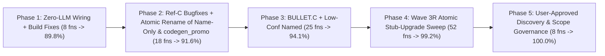

# Warcraft I M2 Completion — Next-Generation Reconstruction Strategy & Quantitative Roadmap

**Starting baseline (`d46f891`):** `899 / 1010 DONE (89.0%)` — **111** in-scope functions remaining (`105 game`, `6 runtime`).
**Target:** `100% DONE` (`make progress --check` exit 0, `make verify` green, Build A `IDENTICAL`), without weakening any verification gate or changing scope without explicit user approval.

---

## 1. Strategic Architecture: Why "Wave 5" Is Not Needed

The empirical audit in [blocker-analysis.md](blocker-analysis.md) proves that the current architecture — **deterministic orchestration + short, isolated, schema-constrained LLM calls + strict `make verify` / Build A `IDENTICAL` / anti-weakening gates** — already works reliably when fed eligible work. It stalled at 89.0% because of **four concrete gaps**, not because the paradigm failed:

1. **No atomic cross-module symbol renamer / TOML migrator** (blocks **80** functions: 61 placeholder stubs without C, 7 locked matched T3s, 5 name-only verified functions, 7 low-conf named functions).
2. **Two narrow `wc1.build`/`wc1.emit` placement limits** (blocks **6** already-matched T3 functions: 1 pre-function switch table + 5 shared epilogues; plus 18 T4 functions beyond M2).
3. **Stale module-level skip & unwired artifacts** (blocks **12** functions: 10 clean `BULLET.C` functions + 1 unwired buildable T3 + 1 unwired passing T4 test).
4. **8 binary-discovery / scope-classification artifacts** requiring explicit user governance (`2` data-in-code tables, `2` `STATUS.C` split blocks, `4` third-party Miles AIL mixer assembly functions in `mod_3df40`).

Therefore, the optimal next-generation strategy is **not** a new monolithic "Wave 5" framework. It consists of **five focused, composable workstreams** extending existing `wc1.*` primitives:

---

## 2. Proposed Workstreams (Design Specification)

### Workstream W1 — Deterministic Zero-LLM Wiring & Buildability Extensions (`Phase 1`)
- **Target blocker classes:** `unwired_buildable_t3` (1), `unwired_passing_t4_difftest` (1), `unbuildable_t3_pre_function_jump_table` (1), `unbuildable_t3_shared_epilogue` (5).
- **Target addresses (8):** `0x23170`, `0x1bf94`, `0x157e8`, `0x1e380`, `0x2315c`, `0x2e96c`, `0x2efd0`, `0x2f73c`.
- **Expected backlog reduction:** **8 functions → 907 / 1010 DONE (89.8%)**, **+7 T3, +1 T4**, **0 LLM calls**.
- **Deterministic vs LLM responsibilities:** **100% deterministic (0 LLM calls).**
- **Required infrastructure changes:**
  1. `tools/wc1/build.py` (`place()`): generalize `base = e["addr"] - pub[1]` when `pub[1] > 0`, verify leading `_TEXT` bytes & fixups match `war.exe` `[base, min_addr)` and contain no foreign function starts (~25 LOC).
  2. `tools/wc1/emit.py` & `tools/wc1/build.py`: permit external branches into verified in-place T3 cuts via cut-boundary local-label relative offsets (`loc_<ce> - (ce - t)` / `loc_<cs> + (t - cs)`), strictly forbidden for legacy layout (~40 LOC; **VERIFIED** exact byte match via NASM/wlink probe).
  3. Wire `src =` for `0x23170`, `0x157e8`, `0x1e380`, `0x2315c`, `0x2e96c`, `0x2efd0`, `0x2f73c`, and `ref_verified_by =` for `0x1bf94`.
- **Verification gates:** `make verify` green (Build A `IDENTICAL`, 0 regressions, all existing tests pass).
- **Rollback / cache:** Standard atomic git commits (one commit for wiring, one for Fix B1 + `0x157e8`, one for Fix B2 + 5 shared-epilogue T3s).
- **Required tests:** Unit tests in `tests/test_pipeline.py` / `tests/test_emit.py` for pre-function jump table placement, malformed leading bytes rejection, rel8/rel32 cut-boundary jump emission, and legacy-layout rejection.
- **Estimated implementation effort:** **0.5–1 day** (small, surgical, zero-risk changes).
- **Principal risks:** Very low — `wc1.compare` proves byte-for-byte identity of `build/war.exe`. For `0x2315c` (`PLAYFLIC.C`), note `0x23170` sits between `0x2315c` and its caller `0x231cc`, so `0x23170` must also be placed in-place (already guaranteed by wiring `0x23170` first!).

---

### Workstream W2 — Deterministic Atomic Cross-Module Symbol Renamer & TOML Migrator (`Prerequisite for Phases 2–4`)
- **Target blocker classes:** Enables `name_only_placeholder_with_verified_c` (5), `locked_codegen_promo_matched_t3` (7), `cross_toml_placeholder_stub_no_c` (40), `same_toml_placeholder_stub_no_c` (21) — **73 functions total** (100% of placeholder entries!).
- **Deterministic vs LLM responsibilities:**
  - **Deterministic tool (`tools/wc1/symbol_migrate.py`):**
    1. Validates new symbol name is non-placeholder, valid C identifier, and produces a globally unique `symbols.link_name`.
    2. Moves or updates the `[[func]]` TOML block from source TOML (`mod_104b0.toml`, `mod_20c30.toml`, `codegen_promo.toml`, etc.) to target canonical module TOML, preserving all prior evidence and appending new evidence.
    3. Tokenizes every referencing `src/**/*.c` and `src/**/*.h` using the syntax-aware C scanner from `tools/wc1/wave4_deps.py` (skipping comments, string literals, `#include`s, `.field`/`->field` member accesses, and aborting/flagging on local/param/typedef/macro shadowing collisions) to rewrite `old_name` → `new_name`.
    4. Updates `tests/**/*.py` string citations (`"old_name_"` → `"new_name_"`, `"old_name"` in `t4spec.run_spec`/`run_pair` link names) via AST-verified string literal replacement.
    5. Optionally splits multi-function `src/codegen/mod_13f60.c` into 3 single-function files.
  - **LLM (or human analyst):** Supplies ONLY the semantic name, prototype refinement, and disassembly-grounded evidence (never performs bulk cross-repo search-and-replace by hand!).
- **Verification gates:** `make symbols`, `wc1.match --all`, `make compile-check`, `make build` (`IDENTICAL`), full `make verify`.
- **Rollback behavior:** Transactional staging or git-index/worktree rollback on any collision, compile error, or `make verify` failure.
- **Required tests:** Unit tests covering C identifier shadowing, struct member preservation, `#include`/comment/string immunity, `t4spec` link-name updates, TOML block migration, and rollback on collision.
- **Estimated implementation effort:** **1–1.5 days** (reuses `wave4_deps.py` C lexer & `wave4.py` TOML block parser).
- **Principal risks:** Low-medium — accidental rename of a local variable or comment/test string with the same identifier (mitigated by `fn_[0-9a-f]{5}` having near-zero collision risk with ordinary C identifiers, plus AST/tokenizer guards and full `make verify`).

---

### Workstream W3 — Reference-C Bugfixes & Name-Only / `codegen_promo.toml` Promotions (`Phase 2`)
- **Target blocker classes:** `ref_c_behavioural_divergence` (5), `name_only_placeholder_with_verified_c` (5), `locked_codegen_promo_matched_t3` (7), plus `0x150f0` (`codegen_promo.toml` `no C`, 1).
- **Target addresses (18):**
  - **5 ref-C divergences:** `0x231cc`, `0x23530`, `0x23668`, `0x23ae0` (`PLAYFLIC.C`), `0x2fcfc` (`EndScreen`).
  - **5 name-only:** `0x214d4`, `0x26360`, `0x2b308`, `0x2b31c`, `0x2b390`.
  - **8 `codegen_promo.toml`:** `0x1132c`, `0x123cc`, `0x13e94`, `0x150f0`, `0x15170`, `0x15230`, `0x15558`, `0x19478`.
- **Expected backlog reduction:** **18 functions → 925 / 1010 DONE (91.6%)** (crosses **90% DONE** immediately!).
- **Deterministic vs LLM responsibilities:**
  - **5 ref-C divergences:** Strong reasoning model (`claude sonnet/opus` or `gpt-6.2-sol:medium/high`, ~1–2 calls each = 5–10 calls) given the exact failing `pytest --runxfail` divergence trace + disassembly of the 5 functions to patch `player_reference.c` and `end_screen_reference.c`, remove `@_DIVERGES`/`@pytest.mark.xfail`, and wire `ref_verified_by`.
  - **12 already-matched/verified placeholder functions:** 1–2 batched semantic-naming LLM calls (or supervised analyst naming using caller dossiers) → W2 deterministic renamer + 1-fn-per-file split of `src/codegen/mod_13f60.c` → wire `src =` for the 7 `codegen_promo` T3s! (Note: `0x19478` stays OW2 T3 or gets 10.0a spelling.)
  - **`0x150f0` (`mod_13f60`, 43 insns):** Standard single-function reconstruction + W2 migration out of `codegen_promo.toml` (~2 calls).
- **Suggested model requirements:** `gpt-6.2-sol:medium` (or `low` for naming, `medium/high` for `EndScreen`/`IntroPlay` bugfixes); total **~10–18 LLM calls**.
- **Verification gates:** `make verify` green after each atomic unit (1 commit for `EndScreen`, 1 for 4 `PLAYFLIC`, 1 per module for name-only/`codegen_promo`), ensuring xfail count drops `5 → 0`.
- **Estimated effort:** **1 day** execution + verification.

---

### Workstream W4 — Wave 3R (`upgrade-existing`) & `BULLET.C` + Low-Confidence Named Sweep (`Phases 3 & 4`)
- **Target blocker classes:**
  - **Phase 3 (25 functions):** `stale_default_skip_bullet_c` (10), `BULLET.C` stubs in `mod_104b0.toml` (8), `existing_low_conf_named_no_c` (7).
  - **Phase 4 (52 functions):** All 14 remaining `DG-08-stub-area-*` module groups (`mod_20c30`: 14, `mod_13270`: 7, `mod_2ced0`: 6, `mod_1b800`: 4, `mod_1de60`: 4, `mod_19b80`: 3, `mod_1c020`: 3, `PLACEBOX.C`: 3, `mod_25ba0`: 2, `mod_2b400`: 2, `INIT.C`: 1, `mod_12c70`: 1, `mod_1e380`: 1, `mod_25820`: 1).
- **Expected backlog reduction:**
  - Phase 3: **+25 → 950 / 1010 DONE (94.1%)**.
  - Phase 4: **+52 → 1002 / 1010 DONE (99.2%)** (crosses **95% DONE** early in Phase 4, and **99% DONE** at completion of Phase 4!).
- **Required infrastructure changes (extends `batch_driver.py` + `overnight.py`, ~250 LOC total):**
  1. Remove `"BULLET.C"` from `overnight.DEFAULT_SKIP` (keep per-address skip only for `0x28090`/`0x28093` and `mod_3df40` until Phase 5).
  2. Add **`upgrade-existing` mode (Wave 3R)** to `batch_driver.py` & `overnight.py`:
     - Accepts a module chunk whose functions already have `placeholder` or `low`-confidence entries in non-locked tracked TOMLs.
     - **Stage 1 (Semantic):** Generates semantic names, prototypes, and evidence for the chunk (preserving existing semantic names for the 7 `low`-confidence named entries, upgrading confidence to `medium`/`high`!).
     - **Stage 1.5 (Deterministic W2 Migration):** Atomically migrates/updates the TOML blocks and rewrites all caller references across `src/` and `tests/` *before* Stage 2 drafting so the newly drafted C, existing callers, and `wc1.match` all agree on the canonical names!
     - **Stages 2–4:** Identical to existing `batch_driver full` (draft C → Watcom 10.0a compile + `wc1.match` + `permuter` [with `-5r` added!] → bounded repair → T4 `t4spec` difftests → `make verify` → atomic commit covering module files + migrated TOMLs + renamed caller files!).
  3. **Allowlist extension in `overnight.py`:** Expand the per-item commit path allowlist for Wave 3R to include the exact set of files deterministically touched by W2's renamer (logged in a machine-readable manifest `rename_manifest.json`), never an open wildcard.
  4. **Retry & cache strategy:** Keep `overnight.py`'s existing resumable ledger + rollback-to-`build/failed/` + per-chunk `max_chunk_insns = 500`. Note: if Stage 4 fails, rollback cleanly restores all renamed caller files and source TOMLs via git checkout of the manifest paths!
- **Suggested model requirements:**
  - `gpt-6.2-sol:low` for the ~70 routine `OPT` functions (proven cost-effective in the recent Wave 2/3 runs: ~1.8–2.0 calls per completed function!).
  - Escalate to `gpt-6.2-sol:medium` or `claude sonnet/opus` only for the 3 complex functions (`0x1c300` 361i `DBG`, `0x12f24` 185i, `0x11a10` 184i) and any chunk that fails once on `low`.
- **Expected LLM budget (DERIVED from recent Wave 2/3 empirical rate of ~1.9 calls/fn + 30% retry headroom):**
  - Phase 3 (25 fns): ~45–65 model calls (~5–7 chunks).
  - Phase 4 (52 fns): ~95–135 model calls (~12–16 chunks across 14 modules).
- **Special attention / expert-review watchlist within Phases 3–4 (4 functions):**
  - `0x1c300` (`mod_1c020`, 361 insns, `DBG` frame — largest unreconstructed function).
  - `0x19c14` (`mod_19b80`, 124 insns, 14-entry pre-function switch jump table at `0x19bdc` — automatically buildable as T3 once Workstream W1 Fix B1 lands!).
  - `0x1b00c` (`ViewportLayerCallback`, 19 insns, branches into `FogDrawViewport` `0x1af90`) & `0x2e9c4` (`mod_2ced0`, 14 insns, branches into `UnitFinalizeGone` `0x2e96c` — shared epilogue!).
  - `0x12f24` (`mod_12c70`, 185 insns, network record reader) & `0x2c57c` (`PathScan`, 163 insns, pathfinder).
- **Principal risks:**
  - *Cross-file rename merge/rollback hygiene:* Mitigated by explicit `rename_manifest.json`, exclusive worktree, and full `make verify` before commit.
  - *T4 test writing for complex UI/network functions (`0x1c300`, `0x12f24`, `0x2c57c`):* May need 1–2 higher-reasoning calls if `gpt-6.2-sol:low` struggles with stub setup.

---

### Workstream W5 — User-Approved Binary Discovery & Scope Governance (`Phase 5`, Fixed-Finish-Line Gate)
Per `AGENTS.md`, **only the user may change scope or discovery/progress gates**. No automated pipeline should unilaterally apply these; instead, present a concise, evidence-backed proposal to the user for approval:

1. **Proposal G1 — Data-in-code veto (`0x110a0`, `0x11530`, 2 non-functions):**
   - *Evidence (**VERIFIED**):* `0x110a0` (4B `00 01 ff 00`, `wander_direction_offsets`) and `0x11530` (8B `01 09 05 07 00 08 04 06`, `train_priority_odd`) are read-only lookup arrays already typed in `datas_db` and referenced solely as data operands (`0x112a5`, `0x117d8`/`0x117d0`).
   - *Action if approved:* Veto `code-ptr` discovery seeds whose address is a verified `[[data]]` table (or exclude known data-in-code bytes from `_closure`), reducing in-scope by 2.
2. **Proposal G2 — Merge `STATUS.C` split blocks (`0x28090`, `0x28093`, 2 mid-function blocks):**
   - *Evidence (**VERIFIED**, already deferred to user in `AGENTS.md` Next Step 7):* `0x28074..0x280a2` is a single function (`SelectionHasNoWorkers`). `0x28093` jumps backward into `0x2807d` (not a function entry!); `0x28090` (`xor eax, eax; ret`) is its shared early-return tail also referenced as a data callback pointer.
   - *Action if approved:* Merge `0x28093` into `0x28074` (and handle `0x28090` either as merged shared return or a standalone 3-byte T3 `ButtonNeverAvailable` — note: **0x28090 CAN actually be built as a 3-byte T3 function** `int ButtonNeverAvailable(void) { return 0; }` if `0x28074` uses Fix B2 cut-boundary jump or stays T4, leaving ONLY `0x28093` as a discovery merge!).
3. **Proposal G3 — Reclassify Miles AIL mixer assembly (`0x3fe34`, `0x4002a`, `0x40088`, `0x400b4` in `mod_3df40`, 4 functions):**
   - *Evidence (**VERIFIED**):* 100% of callers are `ail_dig` (`ail_dig_timer_service`, `ail_init_dig_driver`, `ail_dig_alloc_buffers`, `ail_init_dig_globals`); prologues use MASM/TASM `push ds; push es; cld; ... leave`; `0x400b4` DPMI-locks its own range `0x3fe34..0x400b4`. These are Miles AIL's `MIXER.ASM` routines linked inside the clib address range.
   - *Action if approved:* Split `0x3fe34..0x400e4` out of `mod_3df40` in `analysis/modules.toml` as `kind = "ail"` (out of scope, matching the other 156 Miles AIL functions).
   - *Fallback if user declines:* Keep in scope and write 4 pure-C T4 behavioural equivalents (without `__asm`) verified via `wc1.cemu` difftests (~4–8 LLM calls, T4 only; T3 is impossible because original is hand-written assembly).

---

## 3. Quantitative Roadmap to 100% DONE (No Double-Counting)

### 3.1 Phase-by-Phase Progression (Expected Scenario)

| Phase | Workstream / Description | Newly Completed (or Scope-Resolved) | Cumulative DONE / Scope | DONE % | Expected T3 / T4 Split | Remaining Backlog | Infra Effort | Expected LLM Calls | Risk |
|---|---|---:|---|---:|---|---:|---|---|---|
| **Baseline** | Verified HEAD `d46f891` | — | `899 / 1010` | **89.0%** | `519 T3 / 385 T4` | **111** | — | — | — |
| **Phase 1** | **W1:** Zero-LLM wiring (`0x23170`, `0x1bf94`) + Fix B1 (`0x157e8`) + Fix B2 (5 shared-epilogue T3s) | **+8** (confirmed det.) | `907 / 1010` | **89.8%** | `+7 T3 / +1 T4` | **103** | 0.5–1 d | **0** | Very low |
| **Phase 2** | **W2 + W3:** Atomic renamer + 5 ref-C bugfixes (`PLAYFLIC`+`EndScreen`) + 5 name-only + 8 `codegen_promo` | **+18** | `925 / 1010` | **91.6%** | `+7–8 T3 / +6 T4` *(+5 already C)* | **85** | 1–1.5 d (W2) | **10–20** | Low |
| **Phase 3** | **W4 (part 1):** Unskip `BULLET.C` (10 clean + 8 stubs) + 7 low-conf named (`no C`) | **+25** | `950 / 1010` | **94.1%** | `+10–14 T3 / +11–15 T4` | **60** | 1–1.5 d (W4) | **45–65** | Low |
| **Phase 4** | **W4 (part 2):** Wave 3R atomic stub-upgrade sweep across 14 remaining modules | **+52** | `1002 / 1010` | **99.2%** | `+20–30 T3 / +22–32 T4` | **8** | 0 d (uses W4) | **95–145** | Low–Med |
| **Phase 5** | **W5 (Governance):** User-approved discovery & scope fixes (2 data-in-code, 2 `STATUS.C` split, 4 AIL mixer) | **8** *(scope/discovery)* | `1002 / 1002` *(or `1006 / 1006`)* | **100.0%** | `0` *(+4 T4 if AIL kept in scope)* | **0** | 0.5 d | **0** *(or 6–10)* | Governance approval |
| **Total** | **End-to-end M2 completion** | **111** | **100%** | **100.0%** | **~563–578 T3 / ~424–439 T4** | **0** | **3–4.5 d** | **150–230** | |

*(Confirmed mechanically unlockable without LLM: **16** [8 in Phase 1 + 8 governance-gated in Phase 5]. Speculative/estimated LLM-assisted: **95** [18 Phase 2 + 25 Phase 3 + 52 Phase 4].)*

### 3.2 Shortest Credible Path to Key Milestones

- **90% DONE (`909 / 1010`, +10 functions):** Phase 1 (**+8**, 0 LLM calls) + any 2 of the 5 `name-only` functions (or 2 `codegen_promo` promotions) in Phase 2. Achievable in **~1–2 days** with **<5 LLM calls**.
- **95% DONE (`960 / 1010`, +61 functions):** Complete Phases 1–3 (`950 / 1010`) + the first module of Phase 4 (`DG-08-stub-area-mod_20c30`, 14 functions → `964 / 1010`, **95.4%**). Achievable in **~3–4 days** with **~80–115 LLM calls**.
- **99% DONE (`1000 / 1010`, +101 functions):** Complete Phases 1–4 → **`1002 / 1010` (99.2%)**. Achievable in **~4–6 days** with **~150–230 LLM calls** (well within ~10–15% of a single weekly Codex Plus budget, based on observed Wave 2/3 telemetry).
- **100% DONE:** Phase 5 user-approved governance resolution of the remaining 8 non-Watcom-C/non-function artifacts (2 data-in-code + 2 `STATUS.C` split blocks + 4 AIL mixer asm). **There is zero technical obstacle blocking 100% DONE once these 8 governance items are decided.**

### 3.3 Conservative / Expected / Optimistic Scenarios (Phases 1–4, 103 Functions)

| Scenario | Total LLM Calls | Automated Commit Yield (Phases 3–4) | Functions Needing Supervised Expert Pass | Wall Time (incl. `make verify` @ 53s) |
|---|---:|---:|---:|---|
| **Optimistic** | ~140 | ~92% first-pass (`gpt-6.2-sol:low`) | 2 (`0x1c300`, `0x2fcfc`) | ~2.5–3 days |
| **Expected** | ~185 | ~80% first-pass (`low` + `medium` escalation) | 5–6 (`0x1c300`, `0x2fcfc`, `0x12f24`, `0x2c57c`, `0x19c14`, `0x1b00c`) | ~4–5 days |
| **Conservative** | ~270 | ~65% first-pass (2× retry + manual T4 stubs) | 10–12 (large/UI/net functions + `PLAYFLIC` stubs) | ~6–8 days |

---

## 4. Recommended Next Implementation Campaign

**Start immediately with a tightly scoped 2-part Implementation Campaign (`feature/m2-unlock-infra`):**

1. **Part A (0.5–1 day, immediate +8 DONE at 0 LLM cost):**
   - Wire `IntroOpSyncSound` (`0x23170`) and `WaitInputOrTimeout` (`0x1bf94`) → **+2 DONE**.
   - Implement **Fix B1** (pre-function jump tables in `wc1.build.place`) + wire `ChooseCampaignDialog` (`0x157e8`) → **+1 DONE** (+12 T4s unblocked for future Wave 4).
   - Implement **Fix B2** (cut-boundary local-label relative jumps in `wc1.emit`/`wc1.build`) + wire all 5 shared-epilogue T3s (`0x1e380`, `0x2315c`, `0x2e96c`, `0x2efd0`, `0x2f73c`) → **+5 DONE** (total `907 / 1010`, **89.8%**).
   - Add `-5r` to `wc1.permuter.FLAG_PRESETS` (6 lines — immediately improves T3 hit rate of Phases 3–4 and unlocks +14 T3s whenever Wave 4 runs next!).
2. **Part B (2–2.5 days, unlocks the remaining 95 LLM-assisted functions):**
   - Implement **W2** (`wc1.symbol_migrate` atomic cross-module renamer & TOML migrator) + full unit tests.
   - Implement **W4** (`batch_driver upgrade-existing` + `overnight` Wave 3R queue integration + remove `"BULLET.C"` from `DEFAULT_SKIP`).
   - Run **Phase 2** (5 ref-C bugfixes + 13 name-only/`codegen_promo` migrations → **91.6% DONE**), then launch supervised **Phase 3–4** Wave 3R sweeps to **99.2% DONE**, and submit **Proposals G1–G3** (Phase 5) to the user for final **100.0% DONE** sign-off.

---

## 5. Principal Risks, Alternatives Considered & Unresolved Questions

### Alternatives Considered & Rejected
- **Alternative A: Keep `fn_XXXXX` names in `src/` and only add C without renaming.** *Rejected:* `wc1.progress.is_semantic()` explicitly rejects `PLACEHOLDER` names, so functions remain not-DONE until semantically named; renaming must happen atomically with callers.
- **Alternative B: Write T4 difftests for the 6 unbuildable T3s instead of fixing `wc1.build`/`wc1.emit`.** *Rejected:* Downgrades already byte-exact T3 C to T4 and fails to unlock the 18 additional T4 functions blocked by the exact same pre-function jump table and shared-epilogue mechanisms.
- **Alternative C: Launch a Wave 4B T4→T3 campaign before finishing M2.** *Rejected:* Wave 4B advances T3%, not DONE%. Fix `-5r`, multi-fn splitting, iterative feedback, and `omf_deps` refresh *after* M2 hits 100% DONE (or opportunistically via the 6-line `-5r` preset addition).

### Unresolved Research Questions (UNKNOWN / Open)
1. **User governance decision on Proposals G1–G3 (8 functions):** Whether the user approves removing `0x110a0`/`0x11530` (data-in-code), merging `0x28093` (and `0x28090`) in `STATUS.C`, and reclassifying `0x3fe34..0x400e4` (`mod_3df40`) as `kind = "ail"` — or prefers keeping `0x3fe34..0x400e4` in scope as T4 C equivalents.
2. **Exact root cause of the 4 `PLAYFLIC.C` `@_DIVERGES` stub-call mismatches (`0x231cc`, `0x23530`, `0x23668`, `0x23ae0`):** We verified they are marked `_DIVERGES` in `tests/test_playflic_t4.py`, but did not execute a per-line disassembly diff of `player_reference.c` during this analytical campaign (scheduled for Phase 2).
3. **Additional Watcom 10.0a flag presets beyond `-5r` (secondary track):** Whether `-3r`, `-or`, `-om`, or `-oi` unlock additional zero-LLM T3 matches across the 362 dep-clean Wave 4B T4s remains untested (`UNKNOWN`; bounded probe in Phase 1 or post-M2 takes <10 seconds).
4. **Full prototype fidelity of the 60 placeholder stubs:** Several `mod_104b0.toml`/`mod_20c30.toml` stubs have `low`-confidence prototypes inferred from call sites; when Wave 3R reconstructs the callee's full body, a small fraction (~5–10%, **HYPOTHESIS**) may reveal a refined argument/return type requiring a header/caller prototype update alongside the rename.
